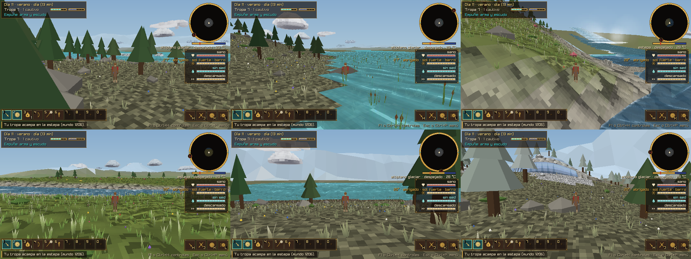
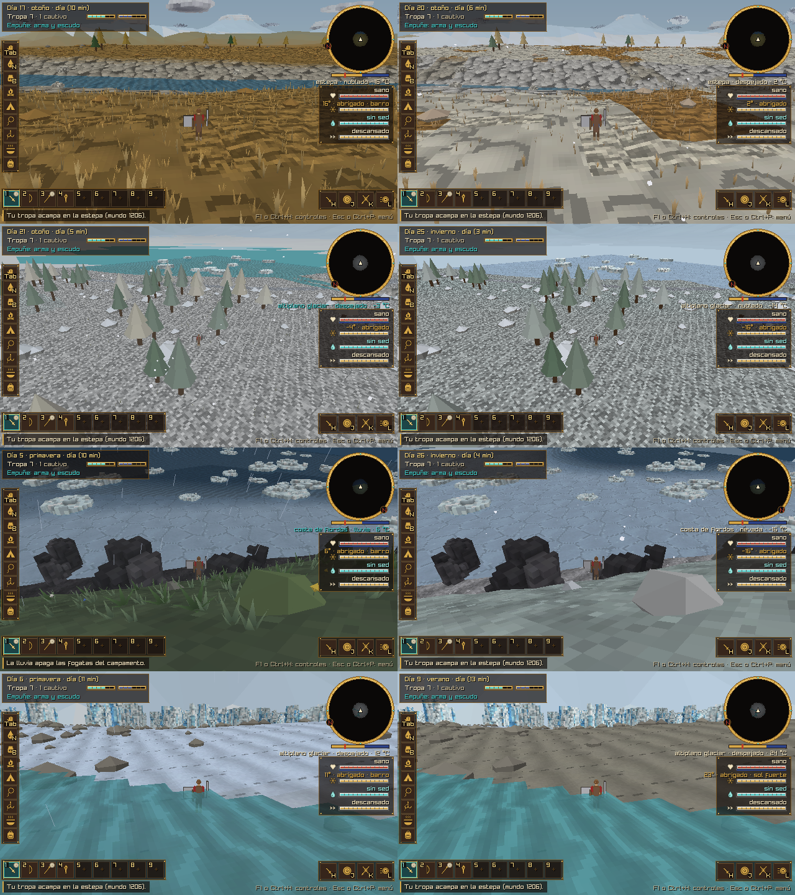
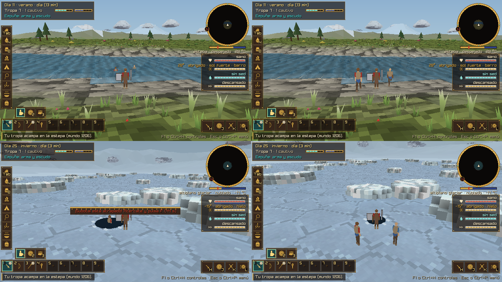
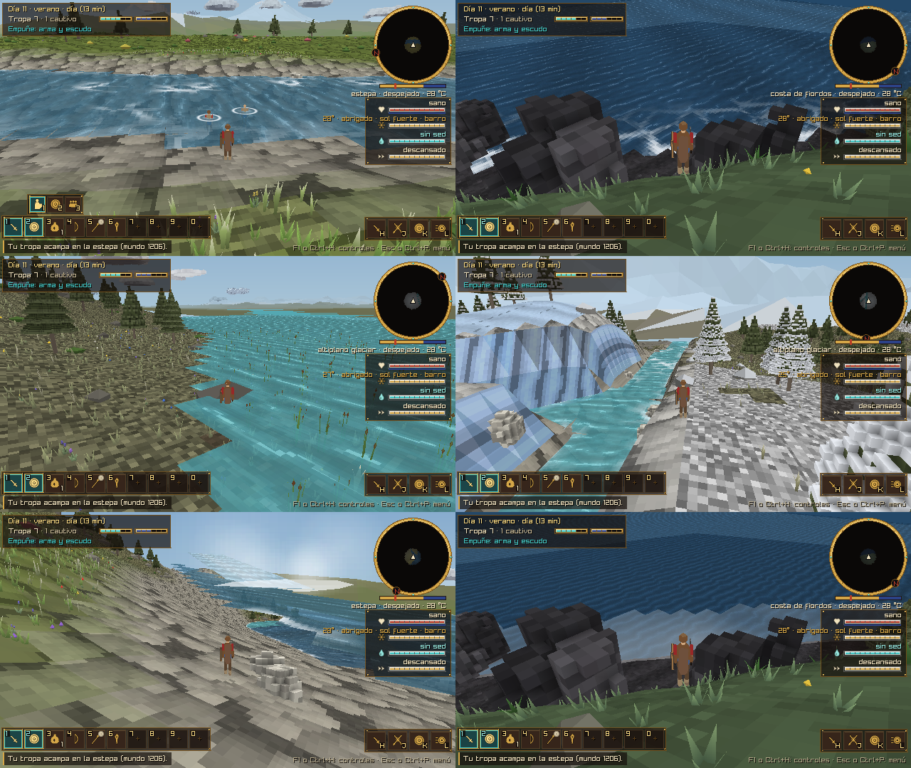
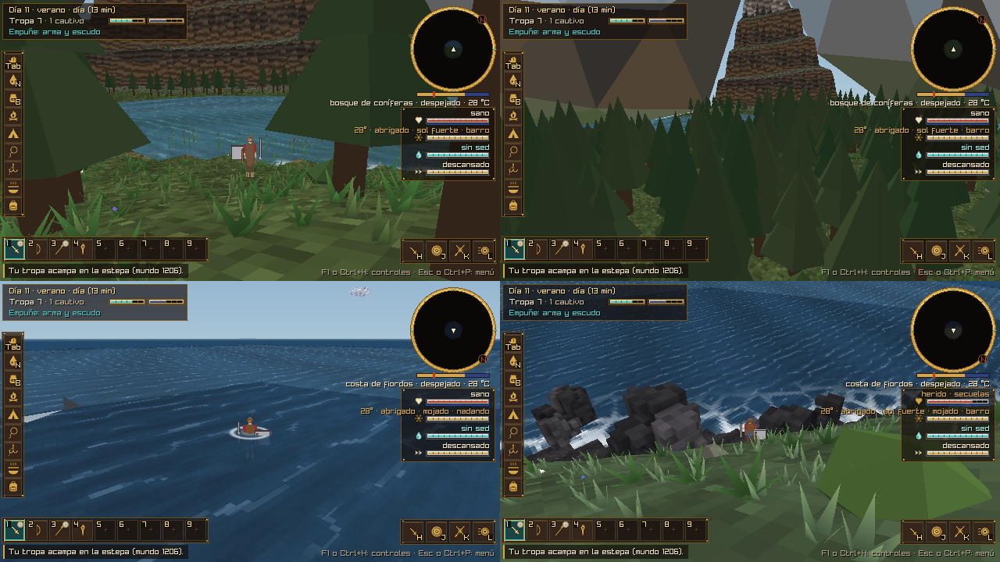

# El agua: ríos, lagos, hielo y mar

El diseño del usuario (seis páginas a mano, noviembre de 2026), pasado a reglas del juego y repartido en cinco
fases. Ya están la **fase 1 (v0.11.0)**: el agua baja por donde debe y los lagos llenan sus depresiones; la
**fase 2 (v0.11.1)**: cada agua cambia con las estaciones (se seca, se hiela, el mar se congela en la costa y el
glaciar avanza y retrocede); la **fase 3 (v0.11.2)**: la tribu, los enemigos y los animales vadean, nadan y caen
al romperse el hielo, y con el picahielo se abre un agujero para pescar; la **fase 4 (v0.11.3)**: el agua tiene su
shader, con el vaivén de los lagos, la corriente de los ríos, las olas en la costa, la espuma y la bruma de las
cascadas; y la **fase 5 (v0.11.4)**: los bordes, con el muro de roca tras el canal del bosque y el mar abierto, donde
espera el tiburón. Están todas.

*Un lago del altiplano · el desborde de un lago glaciar, por donde sale su río · una cascada en la estepa · un
río de meandros en la estepa · un río trenzado del deshielo · un arroyo junto al glaciar (`--ir lago`,
`desborde`, `cascada`, `meandro`, `trenzado`, `arroyo`).*

## El diseño, página por página

| Página | La regla | Estado |
|---|---|---|
| **1. El nivel del mar es la base** | Las alturas medias bajan del altiplano al desierto, la estepa, el bosque y la costa, hasta el mar. | **Hecho (v0.11.0).** Altiplano ~82 m, desierto ~61, estepa ~40, bosque ~33 y costa ~26 (las medias medidas, con su relieve; `ALTITUDE[]` en `src/sim/world.c`). |
| **2. Agua sobre el nivel del mar** | Los lagos están en las depresiones del altiplano, la estepa y el bosque. | **Hecho.** Cada depresión del relieve es un lago (también en la costa). El desierto solo tiene oasis. |
| **3. Aguas abajo y estaciones** | En verano el glaciar retrocede y los cauces se llenan, y los ríos alimentan los lagos. En invierno los cauces quedan secos (la «huella») y los lagos se hielan. | **Hecho (v0.11.1).** Los ríos del glaciar corren de mediados de la primavera a mediados del otoño; con helada se secan y queda su cauce de grava con unos charcos helados. La lengua del glaciar retrocede en verano. |
| **4. Cambios de altura** | El agua siempre necesita una superficie por donde deslizarse y siempre cae. Sin superficie, es una cascada. | **Hecho.** El nivel de un río nunca sube. Donde cae 3 m o más con una pendiente de más del 25 %, hay una cascada: una cortina de agua con espuma al pie. Desde la v0.11.3 la cortina baja y al pie hay bruma. |
| **El mundo: un disco de cinco biomas** | Cada bioma tiene su borde y, entre biomas, transiciones con cordilleras y ríos. A tiene muros de hielo. B tiene un gran canal con acantilados y ríos sinuosos, y del otro lado, paredes de roca. D tiene un cañón con un muro de estratos. F tiene la costa con fiordos y un mar accesible hasta un límite. | **Hecho.** Los bordes de A, B, D y F ya existían. Las **cordilleras** entre el altiplano y el desierto, y entre el altiplano y la costa, están hechas. Desde la v0.11.4, del otro lado del canal se alza un muro de roca de estratos levantados, y el mar se nada hasta la línea del tiburón. Tu croquis tiene la misma vecindad que el juego (A frente a B, D frente a F): no se movieron regiones. |
| **5. El invierno** | a) Los lagos se cubren de hielo, que se rompe (peligro) o se perfora para pescar. b) Unos ríos se hielan y otros se secan. c) Hay hielo en la costa y témpanos en el mar. d) Los glaciares retroceden en verano. | **Hecho.** a) Cada lago y cada río tiene su hielo, que se cruza y se rompe bajo el jugador, la tribu, los enemigos y los animales (`src/sim/hazards.h`, con rescate); con el picahielo se abre un agujero para pescar (v0.11.2). b, c y d: v0.11.1. |
| **6. Las texturas** | a) Vaivén en lagos y lagunas. b) Torrente en ríos y cascadas. c) Espuma en las orillas y donde el terreno o alguien toca el agua. d) Olas que entran y se retiran. | **Hecho (v0.11.3).** El shader del agua: el vaivén de los lagos, la corriente de los ríos por su cauce, el oleaje del mar con las olas que entran y se retiran, y la espuma de las orillas, las rocas, los rápidos y de quien está en el agua. |
| **7. La hondura** | En lo bajo se camina por el fondo, en lo hondo se nada, en invierno se camina sobre el hielo y el hielo se rompe. | **Hecho (v0.11.2).** El jugador, la tribu y los enemigos vadean hasta 1,2 m y nadan más hondo; cruzan un río a nado y rodean un lago. Los animales vadean según su tamaño y cruzan un río a nado si tienen prisa. Todos cruzan el hielo que aguanta y los cauces secos, y el hielo se rompe bajo todos. |
| **8. El trazado de los ríos** | Desde donde nace, el río baja por la cota más baja; los ríos se ramifican como raíces. | **Hecho.** Priority-Flood más la suma del agua (abajo). |
| **9. El agua necesita un contenedor** | El nivel de un lago es la altura de su punto de salida más bajo (el desborde), y de ahí sale su río. | **Hecho.** |

## La fase 1 (v0.11.0): el agua baja

Todo está en `src/sim/hydro.c` (la hidrología, genérica) y en `make_water()` de `src/sim/world.c` (el
mundo). Se calcula una vez por semilla, al generar el mundo: unos 110 a 150 ms en una PC.

1. **La grilla.** Son 288 × 288 celdas de 40 m, que cubren todo el mundo y algo de afuera. Cada celda tiene:
   - su altura sin agua (`world_land`), con la cuenca del lago del campamento;
   - qué es: tierra o una salida (el mar de los fiordos, el canal del bosque, el cañón del desierto o
     afuera del mundo);
   - cuánta agua recibe. La lluvia por región: bosque y costa 1, altiplano 0,75, estepa 0,55 y desierto 0
     (en el desierto no nace ningún río). El **deshielo** suma 14 en el pie del muro de hielo y sobre la nieve
     de todo el año.
2. **Priority-Flood** (Barnes, Lehman y Mulla, 2014; está en RichDEM, `github.com/r-barnes/richdem`). Desde
   las salidas se recorre el terreno de lo más bajo a lo más alto:
   - la celda que alcanza a otra es adonde corre el agua de esa otra;
   - en una depresión, el agua sube hasta su punto de desborde;
   - en lo llano, el agua sube 1 mm por celda, así que siempre corre.
3. **La suma del agua.** Al revés del orden del llenado, cada celda pasa su agua (y su deshielo) a la de
   abajo. Es el mismo principio que usa mapgen4 (`github.com/redblobgames/mapgen4`) para sus ríos.
4. **Los lagos.** Son las celdas cubiertas, vecinas entre sí, cuyo desborde está a la misma altura (±25 cm).
   - Su nivel es el de su desborde.
   - Quedan los de 4 celdas o más, 1,5 m de hondo o más, redondos (no un barranco largo), fuera del desierto
     y lejos del campamento.
   - El lago es un círculo de orilla irregular: crece hasta tapar la depresión.
   - Su nivel queda 40 cm debajo de lo más bajo de su orilla, porque la grilla es gruesa y un bajo entre dos
     celdas no tiene que desbordarlo. El río de salida corta hasta el desborde.
5. **Los ríos.** Nacen donde se juntan al menos 450 celdas de lluvia.
   - El orden: primero el de más agua. Aguas arriba se sigue el brazo con más agua; los otros brazos son
     afluentes que terminan en el punto exacto de su río.
   - Del desborde de cada lago sale su río. El que entra a un lago termina adentro.
   - Si un arroyo chico no se traza (no hay lugar), el que le llegaba sigue por su cauce hasta un río trazado.
6. **Cómo se ven.** Puntos cada 20 m, las esquinas de la grilla redondeadas y la clase según la región y el
   agua:
   - **arroyo** (2 a 3,5 m), por debajo de 2600;
   - **trenzado** (30 a 80 m de lecho de grava), en el altiplano y la costa, desde 9000;
   - **tributario** (6 a 12 m), en el bosque;
   - **de meandros** (6 a 12 m), en lo demás.

   Los meandros van y vienen a los lados en lo llano, sin subir una loma. El nivel queda un poco bajo la orilla
   y nunca sube; no baja del mar ni del canal donde termina.
7. **Los tramos.** Cada río se parte en tramos de una clase y de hasta 96 puntos (`River`). Cada tramo
   guarda:
   - de dónde viene (`RIVER_FROM_RAIN`, `_GLACIER`, `_LAKE`);
   - dónde termina (el mar, el canal, el cañón, un lago, otro río o el tramo siguiente);
   - su agua (`flow`) y la parte que es deshielo (`melt`).
8. **Las cascadas** (`Waterfall`): donde el nivel cae 3 m o más con pendiente. Lo que se hunde en el lago o
   en el río donde termina no cuenta.

**En cada semilla** salen unos 25 a 30 lagos y 130 a 180 tramos de río, con 13 a 22 cascadas. El río más
grande nace del glaciar y llega al mar o al canal. Con esta grilla, `world_height` cuesta lo mismo que antes
(1,4 a 1,6 µs por punto).

**Las pruebas** (`tests/test_main.c`):
- `test_hydro_basics`: la hidrología sobre un terreno de prueba.
  - el agua nunca sube y nada se pierde;
  - el pozo es un lago con el nivel de su desborde, que es lo más bajo de su borde;
  - los valles se juntan;
  - del lago sale un río.
- `test_water_flows_down`: el agua de tres mundos.
  - cada lago tiene su nivel bajo su orilla y un río que sale por su desborde;
  - cada río llega a una salida;
  - el más grande lleva deshielo;
  - las cascadas caen de verdad;
  - hay lagos en la estepa, el bosque y el altiplano, y ninguno en el desierto.
- `test_world_regions_borders_and_sites`: el orden de las alturas, la boca de los tributarios en el canal y
  los tramos que siguen sin saltos.

**Las partidas guardadas.** La semilla es la misma, pero el agua cambió de lugar. Si al cargar el jugador
queda en agua honda, aparece en la orilla más cercana.

## La fase 2 (v0.11.1): las estaciones del agua

Todo es una función pura del clima de ese día (`src/sim/climate.h`) y del mundo: `world_water_now` en
`src/sim/world.c` dice el agua de un punto en una estación (`WaterSeason`), con su hielo, y el juego la consulta
en cada cuadro (`terrain_water`, `terrain_ice`). El agua «completa», la de los cauces llenos, sigue siendo
`world_water`: con ella se generan el mundo, los pueblos y la flora, y no se construye en un cauce aunque hoy
esté seco (`terrain_water_full`).

1. **El clima del agua** (`Climate`):
   - `melt`, el deshielo del glaciar que corre ahora: nada con helada, todo con calor;
   - `temp_late`, la temperatura de dos días antes: la que sienten los lagos grandes y los ríos grandes, que
     se enfrían y se entibian despacio;
   - `sea_ice` y `floes`, el hielo de la costa y los témpanos: siguen la temperatura de tres días antes (el mar
     es lo más lento). Los témpanos llegan antes que el hielo y se van después;
   - `glacier`, cuánto avanzó el frente del glaciar: lo más al empezar la primavera, lo menos al empezar el
     otoño (va detrás del frío).
2. **Los cauces** (`ChannelState`: con agua, seco o helado). Cada tramo corre la parte de su agua que no es
   deshielo, más el deshielo de ahora (`world_river_share`).
   - Con menos del 20 %, el cauce se seca: queda la grava (o los cantos rodados) con unos charcos en lo hondo,
     que se hielan antes que el río.
   - Con menos del 60 %, el nivel baja hacia lo hondo del cauce (en el trenzado, hasta sus canales). Cerca de su
     boca, un tramo baja con el agua que lo recibe, así no queda colgado sobre ella. El río que sale de un lago
     nunca queda más alto que el lago.
   - En el invierno se secan los ríos del glaciar (de 70 a 110 de los 130 a 160 tramos de cada semilla); los
     de la lluvia y los lagos se hielan. Los del glaciar corren de nuevo desde mediados de la primavera.
3. **El hielo** de cada agua (`world_lake_ice`, `world_river_ice`; aguanta desde 0,5, `ICE_WALKABLE`):
   - **la altura:** 0,08 grados menos por metro sobre el campamento (más que en la realidad, para que se note);
   - **el tamaño:** un lago chico sigue el aire de hoy; uno grande, el de dos días antes. Los chicos (el del
     campamento, los oasis) se hielan de uno a tres días antes que los grandes, y los del altiplano antes que
     los de la costa;
   - **los ríos:** los arroyos y los charcos se hielan primero; los ríos grandes y el canal, al final.
4. **El mar** se hiela desde la orilla, donde es bajo (`world_sea_ice`): con más frío, más lejos (hasta 17 m
   de hondo), con el borde irregular. Mar adentro sigue abierto, y los témpanos flotan a la deriva. El hielo de
   la costa se camina y se rompe como el de un lago.
5. **El glaciar** (`world_glacier_reach`): su lengua avanza desde el pie del muro de hielo, en lóbulos, hasta
   unos 400 m al final del invierno, y retrocede en el verano. Deja una morrena de limo y grava, sin pasto ni
   árboles. Arriba, la nieve de todo el año sube y baja como antes (`Climate.snowline`).
6. **Cómo se ve:**
   - las mallas del agua de cada chunk se rehacen cuando la estación cambia lo suficiente (unos centímetros de
     crecida o un cuarto de grado). Lo que no cambia con la estación (qué agua llega a cada vértice,
     `WaterBodies`) se guarda al crear el chunk, así que rehacerlas cuesta menos de 0,1 ms por chunk;
   - cada vértice lleva el color de su agua mezclado con el de su hielo. El hielo que aguanta va en su propia
     malla, con la textura `assets/terrain/hielo.png` (placas con grietas, de `tools/assets/texturas_terreno.py`)
     y sin el brillo de las ondas;
   - las cascadas de un río seco desaparecen; las de uno helado son de hielo, sin espuma;
   - los témpanos del mar son placas de vóxeles (`VF_FLOE`) que salen con el frío y se mecen a la deriva;
   - el horizonte lejano usa la misma agua.
7. **En el juego:** el jugador, la tribu, los enemigos y los animales cruzan los cauces secos y el hielo que
   aguanta (y lo rompen como antes). Los peces no se ven ni se pescan donde el agua se fue. Las construcciones,
   los árboles del campamento y el pasto que puede quemarse miran el agua completa.

*El mismo lugar en dos momentos del año: un río de meandros del glaciar en otoño y ya seco · un lago glaciar
antes y después de helarse · el mar al romperse su hielo en la primavera y helado en invierno · la lengua del
glaciar en la primavera y retirada en el verano (`--ir meandro`, `lago`, `mar`, `lengua`, con `--dia`).*

**Las pruebas** (`tests/test_main.c`, `test_water_seasons`):
- el clima del agua: el deshielo, el hielo del mar (después de los témpanos) y el glaciar, sin saltos;
- la estación llena es el agua de siempre (`world_water`), en todo el mundo;
- en verano todos los cauces llevan agua; en invierno los del glaciar se secan (sin agua o con charcos helados)
  y los de la lluvia y los lagos se hielan;
- en cada estación, ningún tramo sube ni queda más colgado sobre el agua que lo recibe que con los cauces llenos,
  y el río de un lago no queda más alto que el lago;
- los lagos: ninguno helado en verano, todos en el invierno; los altos se hielan antes que los bajos, y los chicos
  antes que los grandes;
- el mar se hiela junto a la costa y no mar adentro;
- el glaciar cubre siempre el pie del muro, más lejos solo en invierno, y nunca fuera del altiplano.

## La fase 3 (v0.11.2): hielo, nado y pesca

1. **Cómo está cada uno en el agua** (`hazard_water_step` en `src/sim/hazards.h`): hasta el tobillo (0,25 m) es
   suelo seco; hasta el pecho (`WADE_PERSON`, 1,2 m en la gente) se vadea al 55 % del paso; más hondo se nada al
   40 %; sobre el hielo que aguanta se camina.
2. **La tribu y los enemigos** (`terrain_wade_step` en `src/world/terrain.h`) vadean, y un agua honda pero
   angosta la cruzan a nado: un río, donde hay dónde hacer pie a menos de 40 m en esa dirección. Un lago o el mar
   los rodean, como antes. Nadando, la cabeza queda afuera (`terrain_body_y`) y nadie dispara (se pelea cuerpo a
   cuerpo). Los carros de guerra siguen sin entrar al agua honda.
3. **Los animales** (`src/sim/animals.c`) vadean según su tamaño (`species_wade`: de 0,3 a 1,2 m) y nadan más
   hondo, más lento. Un río lo cruzan a nado solo si tienen prisa: huyendo, cazando o siguiendo a la manada (los
   de tamaño mediano para arriba); pastando, lo rodean. Un lago o el mar los rodean siempre.
4. **El hielo se rompe bajo todos** (`hazard_ice_break_chance`, con su peso: `hazard_ice_load`):
   - **un animal** pesa según su tamaño: un caballo rompe el hielo delgado más del doble de veces que una cabra.
     El que cae forcejea de 8 a 14 s, perdiendo vida con el frío, y sale asustado por donde vino, o se ahoga;
   - **un enemigo** pesa más a caballo (el caballo sale nadando por su cuenta) y más en carro. Forcejea sin pelear
     (`EN_ICE`), helándose, unos 12 s, y sale y huye. Si lo abaten en el agua, se ahoga;
   - **de la tribu**, el que anda cerca del jugador: queda atrapado como la escolta, sin moverse y con la cabeza
     afuera (`Npc.sunk`), hasta que lo sacas (F junto a él, con el minijuego) o se ahoga.
5. **La pesca en el hielo** (`src/game/fauna_game.c`):
   - el **picahielo** (`utileria.herramienta.picahielo`, un objeto nuevo que va siempre en el equipo, como la
     pala) abre un agujero 1,6 m delante, sobre el hielo que aguanta de un agua de más de 1 m (Tab → Acciones,
     8 s). Hay hasta seis; se hielan de nuevo durante la noche, y quien pisa uno cae al agua;
   - junto a un agujero se pesca (10 s): acude el banco de peces más cercano bajo el hielo, hasta 30 m. Pica más
     cerca, con un banco grande y con una lanza en la mano (`hazard_ice_fish_chance`), y da una carne fresca;
   - los peces ahora viven también bajo el hielo.
6. **Las partidas** guardan quién está hundido (`Npc.sunk`, `Animal.sunk`) y los agujeros para pescar; las
   anteriores cargan sin ninguno.

*La escolta cruza un río a nado y sale a la orilla · un compañero que rompió el hielo espera a que lo saquen ·
el agujero para pescar en el lago helado (`--ir meandro --trampa nado`; `--dia 25 --ir lago`, con
`--trampa hundido` y `--trampa agujero`).*

**Las pruebas** (`tests/test_main.c`):
- `test_animals_swim_and_ice`: un ciervo que pasta no cruza el río; el que huye lo cruza a nado, más lento; un
  lago grande no se cruza; un caballo rompe el hielo delgado más del doble de veces que una cabra; el que cayó no
  se mueve; el débil se ahoga y el fuerte sale;
- `test_animals_keep_out_of_lakes`: sin prisa, ningún animal entra más hondo de lo que vadea;
- `test_hazards_cold_mud_ice`: cómo se está en el agua (en seco, vadeando, nadando o sobre el hielo) y su paso; la
  pesca: sin peces o muy lejos no pica, la lanza y un banco grande ayudan, y nunca es segura;
- `test_action_catalog`: el agujero pide el picahielo.

## La fase 4 (v0.11.3): cómo se ve el agua

El agua tiene su shader (`src/world/terrain.c`): GLSL 330 en la PC y GLSL ES 100 en Android, del mismo código
(solo cambian las palabras de cada versión). Si no compila, el agua se dibuja como antes (las ondas que
respiran y la malla de espuma); `--sin-shader` lo muestra.

1. **Lo que sabe cada vértice del agua** (se arma con la malla de cada chunk: no cuesta nada por cuadro):
   - la hondura: el agua sobre el suelo (bajo la orilla, negativa);
   - la corriente: en los ríos, aguas abajo por su cauce (`world_river_flow`), más rápida en lo empinado y en los
     arroyos, y más lenta con poca agua; en los lagos y el mar, una deriva leve;
   - qué agua es (lago, río o mar) y su hielo, que calma las olas y la espuma;
   - la espuma de las rocas (los cantos del cauce, el basalto y los farallones del mar, los témpanos de los
     lagos) y la de los rápidos, en lo bajo de los ríos con cantos.
2. **El vaivén de los lagos:** el agua sube y baja unos centímetros y dos ondas se cruzan a la deriva, con
   rachas que la aclaran y brillos donde coinciden las crestas.
3. **La corriente de los ríos:** la textura avanza con el agua siguiendo el cauce, sin estirarse (dos fases que
   se turnan: un *flow map*).
4. **El mar:** el oleaje de alta mar y, en la orilla, las olas que entran y se retiran: el agua sube por la costa
   y baja, con una línea de espuma que va y viene. No llegan a toda la costa a la vez.
5. **La espuma:**
   - en las orillas: fina en los lagos y los ríos, la rompiente en el mar;
   - en las rocas y en los rápidos;
   - alrededor de quien está en el agua: el jugador, la tribu, los enemigos y los animales que vadean o nadan
     (hasta ocho, los más cercanos, `wg_ripples`), un anillo que se abre y se cierra, más fuerte si se mueven;
   - hecha de jirones de burbujas (`assets/terrain/espuma.png`, de `tools/assets/texturas_terreno.py`).
6. **Las cascadas:** la cortina tiene la textura de las ondas y baja (unos 5 m/s). Al pie, además de la espuma,
   una bruma de motas blandas que suben, se abren y se desvanecen, más en las caídas altas y anchas. Helada, la
   cortina queda quieta, sin espuma ni bruma.
7. **Para Android:**
   - las cuentas van respecto de un origen cerca del jugador (el chunk donde está), así los números entran en
     `mediump`. Las ondas caben justas en 48 m y el tiempo de los vértices vuelve a empezar cada 120 s: al
     cambiar de chunk o de vuelta, nada salta;
   - el de vértices va en `mediump`, como el shader por defecto de raylib (con `highp`, llvmpipe de Mesa no
     dibuja nada en OpenGL ES);
   - el CI compila el juego para OpenGL ES 2.0 y lo dibuja con Mesa: el shader de Android se prueba en cada PR.

*La corriente del río, con la espuma de quien nada · las olas del mar en las rocas · un lago glaciar por su
desborde · los rápidos de un arroyo · la cascada de cerca, con su bruma · el agua sin su shader (`--ir meandro
--trampa nado`; `--ir mar --dron 6`; `--ir desborde`; `--ir rapidos`; `--ir cascada-pie`; `--sin-shader`).*

**Las pruebas:**
- `test_river_flow` (`tests/test_main.c`): en cada trecho de cada río la corriente va aguas abajo, a lo largo del
  trecho, y el agua nunca sube;
- el CI: el shader carga en GLSL 330 y en GLSL ES 100 (el log dice «el agua con su shader»).

## La fase 5 (v0.11.4): los bordes

1. **El muro tras el canal del bosque** (`land` y `world_forest_wall` en `src/sim/world.c`): unos 20 m más allá de
   la orilla de afuera del canal, la roca sube en ocho estratos hasta unos 120 m. Las capas suben y bajan a lo
   largo del muro (estratos levantados), en grises y ocres, sin árboles; se ve también desde lejos. No se
   alcanza: la frontera invisible sigue en la orilla de adentro, y esa orilla quedó despejada (sin árboles a
   14 m del agua, `world_canal_near`) para que se vea. Los ríos, los lagos y las cascadas no cambiaron.
2. **El mar abierto** (`world_open_sea`): en la costa de los fiordos se nada hasta la **línea del tiburón**, a
   140 m del borde del mundo (`WORLD_SHARK_E`, unos 60 a 160 m mar adentro de la costa). Los fiordos que entran
   tierra adentro quedan lejos de ella.
3. **El tiburón** (`src/game/hazards_game.c`):
   - nadando mar adentro de la línea, a los 2,5 s aparece una aleta gris, con su estela, que da vueltas
     alrededor, cada vez más cerca y más rápido (y un aviso: vuelve hacia la orilla);
   - si vuelves hacia la costa, se aleja;
   - si sigues ahí, a los 11 s muerde. El jugador nunca muere: la pantalla se funde a negro y despierta en la
     playa más cercana hacia tierra adentro (nunca dentro de una roca), con una mordida en el muslo cerrada por
     la sal (no sangra), al menos un tercio de vida y **secuelas**.
4. **Las secuelas** (`Health.sequela`, `src/sim/health.h`): cada mordida suma la mitad (hasta todas). Con todas,
   un cuarto menos de velocidad y el aguante rinde poco más de la mitad: correr y saltar cansan más y se
   recupera más despacio. La vida del jugador lo dice: «herido · secuelas». **No se curan solas**: ni el descanso
   ni los días las bajan. Las curan:
   - **el curandero** del campamento, de a poco, mientras estás en el campamento (unas secuelas completas, en
     90 s);
   - **el druida**, de una vez: «Curar mis secuelas» en su diálogo (F junto a él), por dos hierbas y una miel.
5. **Las partidas** guardan las secuelas de cada uno (las anteriores cargan sin ninguna).

*El muro de roca del otro lado del canal, desde la orilla y desde arriba · la aleta del tiburón alrededor de quien
nada mar adentro · despierta en la playa, herido y con secuelas (`--ir muro-canal`; `--ir canal --dron 45`;
`--ir mar --trampa tiburon`; `--ir mar --trampa mordida`).*

**Las pruebas** (`tests/test_main.c`, `test_borders_and_sequelae`, en tres semillas):
- el mar abierto está mar adentro de la línea y solo en la costa; hasta la línea se llega nadando;
- el muro sube más de 70 m sobre el agua del canal, en escalones, y a lo largo sube y baja; del lado de adentro no
  hay muro, y la frontera deja al jugador ahí;
- las secuelas suman hasta todas, frenan y cansan, no se van con los días (ni con curandero), el curandero las cura
  de a poco y el druida de una vez.
