# Arquitectura de la temprana edad del hierro

La investigación de la parte B del [plan de herramientas](PLAN_HERRAMIENTAS_IA.md): de dónde salen los
edificios del juego. El kit (`src/sim/buildkit.c`) arma cada edificio con piezas de 1 m y reglas con
semilla, al estilo de su región. Cada semilla da otra casa de la misma familia.

Las medidas son aproximadas. Vienen de excavaciones, reconstrucciones experimentales y fuentes
antiguas, y varían mucho de un sitio a otro. Donde las fuentes no coinciden, se indica. A 640x360,
lo que importa es la silueta, los materiales y el color.

## Cada región del juego, un mundo de referencia

| Región (reino) | Referencia | Viviendas | Palacio | Materiales |
|---|---|---|---|---|
| Estepa (el kanato) | Escitas, sakas y Pazyryk (siglos IX–III a. C.) | Yurtas de fieltro y carretas-casa | La gran yurta del kan (la *orda*) sobre una tarima | Fieltro, madera, cuero; oro en los remates |
| Bosque | Hallstatt y La Tène (siglos VIII–I a. C.) | Casas rectangulares de postes, con zarzo y barro y techo de paja; algunas redondas | La sala larga de postes | Madera, zarzo, barro, paja |
| Altiplano | Urartu (siglos IX–VI a. C.) | Casas de piedra abajo y adobe arriba, de techo plano | La sala de columnas sobre una terraza de piedra | Piedra, adobe, madera |
| Fiordos | Las costas del norte (edad del hierro prerromana) | Casas largas de tres naves con muros y techo de turba | La gran casa larga | Turba, piedra, madera |
| Desierto | Bactria y Sogdiana (siglos VII–IV a. C.) | Casas de adobe con patio, techo plano de vigas y barro | La sala de columnas sobre terrazas de adobe | Adobe, tapial (*pakhsa*), madera, caña |

## Los nómadas de la estepa

### La yurta (*ger*)
- **Armazón:** la celosía plegable de las paredes (*khana*), las varas del techo (*uni*) y la corona
  (*toono*), donde entran las varas; dos postes (*bagana*) pueden sostener la corona. Encima, el
  fieltro, atado con sogas.
- **Medidas:** de tres a doce secciones de celosía; la común, de cinco, da unos 25–30 m², o sea unos
  6 m de diámetro. La pared tiene alrededor de 1,7 m y el centro unos 2,4 m (en un plano de 4,9 m de
  diámetro). La corona mide cerca de 1/5 del diámetro.
- **En el kit:** un cilindro de fieltro de 4,5–7 m, un cono hasta 2,4–3 m, la corona y una puerta de
  madera pintada (al frente, +X; en la estepa se orientaba al sur). Las ricas llevan franjas de
  colores y una corona dorada.

### La carreta-casa
- **Hipócrates** (*Sobre los aires, aguas y lugares*): los escitas nómadas viven en carros. Los más
  chicos tienen cuatro ruedas y algunos seis. Van cubiertos de fieltro y armados como casas, de uno o
  tres cuartos. Los tiran yuntas de bueyes, de dos o de tres.
- **Heródoto** (IV, 46): los carros son su única casa y la llevan adonde van.
- **Pazyryk, kurgán 5:** un carro de cuatro ruedas, de más de 1,8 m de diámetro, con una casilla
  desmontable cubierta de fieltro.
- **En el kit:** un carro de cuatro o seis ruedas con una casilla de fieltro abovedada y la lanza al
  frente.

### Kurganes y estelas (para las ruinas, más adelante)
- **Arzhan 1** (Tuvá, siglos IX–VIII a. C.): un sistema radial de cámaras de troncos de alerce bajo
  un túmulo cubierto de grandes lajas.
- **Pazyryk** (Altái): túmulos de piedra de 25–50 m de diámetro y 2–4 m de alto (las fuentes no
  coinciden en el kurgán 5: de 42 a 47 m). Debajo, la cámara de troncos de alerce de paredes y techo
  dobles, en un pozo de hasta 7 m. En el kurgán 5, la caja exterior mide 7,0 × 3,9 m y 2 m de alto.
- **Estelas de ciervo:** de 1200 a 600 a. C. aprox. Suelen medir de 1 a 3 m, las mayores de 4 a
  4,8 m, de granito, con ciervos en vuelo, cinturón y armas. Están junto a los túmulos
  (*khirigsuur*).

## Los reinos agrarios

### Bactria y Sogdiana (el desierto)
- **Material:** grandes adobes rectangulares sin cocer y tapial (*pakhsa*). La madera, para los techos;
  la bóveda, sencilla. Se usan cañas en muros, techos y suelos.
- **Casas:** muros de barro con techo de vigas, cuartos alrededor de un patio y, en algunas, una sala
  abierta (*ayvan*) con columnas de madera.
- **Ciudades:** fosos y murallas gruesas con torres salientes, semicirculares o rectangulares, y
  saeteras.
- **Ciudadela de Kyzyltepa:** de unos 100 × 75 m, con un templo del fuego probable y un patio hundido
  entre terrazas de adobe.
- **En el kit:** casa de adobe sobre un zócalo de piedra, de una planta (a veces con un cuarto
  arriba), en bloque, en L o con patio. El techo es plano: las vigas asoman en la fachada y encima
  van la caña, el barro y un pretil. Ventanucos altos, una escalera al techo, el horno de pan en el
  patio, cántaros junto a la puerta y el marco azul.

### Urartu (el altiplano)
- **Teishebaini** (Karmir Blur, siglo VII a. C.): los muros bajos son de piedra y los altos de adobe,
  que se cayó en el incendio que tiñó el cerro de rojo. Tenía muralla con torres y contrafuertes,
  puertas macizas, un patio de armas y depósitos en la planta baja.
- **Salas de columnas:** en Altıntepe, una sala de audiencias de unos 44 × 25 m (dato sin verificar
  del todo).
- **En el kit:** la casa lleva muros de piedra de cerca de 1 m y adobe encima. El techo es plano, de
  vigas y tierra, a veces con un porche de postes. El palacio es una sala de columnas de madera sobre
  basas de piedra, en una terraza con escalinata al frente.

### Hallstatt y La Tène (el bosque)
- **Heuneburg** (hacia 600 a. C.): un muro de adobe de 3–4 m sobre un cimiento de piedra caliza, con
  torres salientes; es único al norte de los Alpes. La puerta tenía 16 m de fondo y 10 m de ancho,
  con un paso de 2,5 m. Duró unos 70 años; después volvió la muralla de madera y tierra.
- **El *murus gallicus*** (los *oppida* de La Tène): un entramado de vigas relleno de tierra y piedra,
  con la cara de piedra y las cabezas de las vigas a la vista. En Basilea medía unos 6 m de alto y
  12 m de espesor.
- **Las casas:**
  - rectangulares, de postes (de seis postes, de tres naves) y también redondas;
  - paredes de zarzo con barro;
  - techos de paja.
- **Casas redondas** (Gran Bretaña e Irlanda): suelen medir de 6 a 9 m, pero van de menos de 5 a más
  de 15 m. Las paredes son de postes con zarzo y barro, a veces encaladas y pintadas. El techo es un
  cono de paja sin chimenea: el humo sale por la paja.
- **En el kit:** la casa rectangular de postes con paneles de zarzo y barro, con un techo de paja muy
  inclinado y alero. A veces es redonda, con techo cónico. Al lado, leña y un bastidor con pieles.

### Las costas del norte (los fiordos)
- **La casa larga de tres naves:** dos hileras de postes cargan el techo, y la gente y el ganado
  viven bajo el mismo. Es una forma muy constante desde la edad del bronce hasta la Edad Media.
- **Largo:** en Dinamarca, las más antiguas de la edad del hierro miden en promedio 16–17 m; después,
  20–22 m. Son de madera con zarzo y barro. La turba aparece donde falta madera (Islandia, más tarde).
- **En el kit:** casa larga de 12–20 m, con muros de turba sobre piedra, techo de turba con hierba,
  la puerta en el costado largo y un secadero de pescado al lado.

### Los talleres: el horno de cuba
- **El horno:** una chimenea de barro (con arena y paja) de unos 50 cm de diámetro por fuera y cerca
  de 1 m de alto. Hay de 0,65 a 1,5 m de alto y de 25 a 50 cm de diámetro interior, con paredes de 5
  a 12 cm.
- **El aire y la escoria:** la tobera entra con 20–25° de caída. La escoria sale por un arco abajo o
  cae a un pozo. Antes hubo hornos de cubeta, más bajos.
- **En el kit:** el horno de cuba de barro rojizo, con la tobera y el fuelle de cuero, un montón de
  escoria oscura, el carbón, el yunque y un cobertizo al estilo de la región.

### Los graneros sobre postes
- **Medidas:** en la reconstrucción de Butser, una caja de 1,3 × 2 m y 1,75 m de alto, sobre postes
  de roble enterrados medio metro; guardó 500 kg de grano un año. Los agujeros de los postes suelen
  medir unos 0,4 m.
- **Muchos:** en Clifton Quarry (Worcestershire) se levantaron al menos 89 entre 600 y 300 a. C.
- **En el kit:** una caja de tablas o de zarzo de 1,5–2,5 m sobre cuatro o seis postes, a 0,6–0,9 m
  del suelo, con techo de paja o de turba. En el desierto, un depósito de adobe con silos en cúpula.

### Los templos del fuego
- **Tepe Nush-i Jan** (Media, siglos VIII–VII a. C.): el «templo central», de adobe, de planta en
  cruz o en rombo escalonado, se interpreta como un santuario del fuego (hay quien lo discute). En
  Kyzyltepa (Bactria) hay otro probable.
- **En el kit:** templo de adobe de planta en cruz, con el altar del fuego escalonado en la sala del
  centro (desierto y altiplano).

## Del estudio al kit

- **Piezas** (rejilla de 1 m, cuatro celdas de voxel por metro): muro (de adobe sobre zócalo, de
  piedra, de postes con zarzo y barro, de turba sobre piedra o de fieltro), poste, viga que asoma,
  alero, techo (plano de barro con pretil, a dos aguas de paja o de turba, cónico de paja o de
  fieltro), puerta, ventanuco, escalera y patio.
- **Reglas con semilla:**
  - la planta: bloque, L o patio; rectangular, redonda o larga;
  - las medidas dentro de los rangos de arriba;
  - la puerta siempre al frente (+X), hacia la calle;
  - las ventanas;
  - los detalles al azar: vigas que asoman, leña, cántaros, pieles al sol, el horno de pan, escalera
    al techo, franjas del fieltro.
- **Variantes:** el juego tiene cuatro de cada tipo y región. Cada casa de una ciudad toma una, así no
  se repiten las vecinas.
- **Presupuesto:** cada edificio cabe en su huella y queda bajo un tope de caras de voxel, por el
  rendimiento en Android. Los tests (`test_buildkit`) lo comprueban, con la puerta que entra y los
  muros cerrados.

## El kit en el juego (v0.10.0)

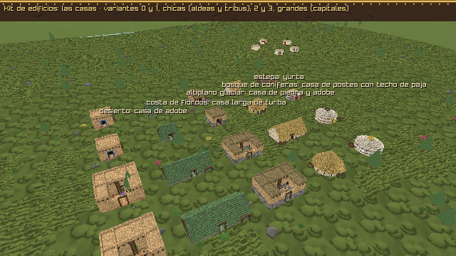

`src/sim/buildkit.c` (C puro, con tests) arma ocho tipos, cada uno al estilo de su región:

| Tipo | Estepa | Bosque | Altiplano | Fiordos | Desierto |
|---|---|---|---|---|---|
| Casa | Yurta de fieltro (blanco o gris), con franjas, sogas y corona | Casa de postes con zarzo encalado y paja a dos aguas, o redonda con techo cónico y porche | Piedra abajo y adobe arriba, techo plano con pretil; en bloque, en L, con patio o con un cuarto arriba | Casa larga de turba sobre piedra, con hierba en el techo y el secadero de pescado | Adobe sobre zócalo de piedra, azul en la puerta; en bloque, en L, con patio (y el horno de pan) o con un cuarto arriba |
| Palacio | La orda del kan sobre su tarima, con los estandartes de crin y, a veces, las yurtas de las esposas | La sala larga de postes y paja, con escudos en el muro | La sala de columnas sobre su terraza, con contrafuertes y, a veces, una torre atrás | La sala larga de turba, con escudos | La sala de columnas con torres en las esquinas y la franja azul |
| Fundición | El horno de cuba de barro, la tobera, el fuelle de cuero, la escoria, el carbón y el yunque, bajo el cobertizo de la región (toldo de cuero, paja, turba o techo plano) | | | | |
| Cuartel | La casa larga de la región, con el armero de lanzas | | | | |
| Carpintería | Cobertizo con troncos apilados, el caballete y las tablas | | | | |
| Granero | Sobre postes (cuatro o seis), con escalera y trampilla | | | | De adobe, con sus silos en cúpula |
| Templo del fuego | — | — | De piedra y adobe | — | De adobe, con almenas escalonadas |
| Carreta-casa | Cuatro o seis ruedas, la bóveda de fieltro (uno o tres cuartos) y el yugo | — | — | — | — |

- **Chicas y grandes:** las variantes 0 y 1 caben en 7 × 7 m (las aldeas y las tribus); la 2 y la 3
  son las de la capital (las casas grandes, de 7 a 12 m).
- **Lo de adentro no se ve:** con las puertas cerradas, lo que no se alcanza desde afuera y tiene
  techo es un cuarto, y se rellena (de un color oscuro) menos un vestíbulo de 1,25 m detrás de cada
  puerta; un patio, al cielo, queda abierto. Por las puertas y las ventanas se ve oscuro, y la malla
  tiene la mitad de caras.
- **Dos niveles de detalle:** a menos de 32 m de la cámara, el modelo refinado (el doble de
  resolución, con las esquinas redondeadas); más lejos, el simple. El refinado se arma la primera vez
  que hace falta.
- **La puerta en el modelo:** cada edificio dice dónde está su puerta y a qué altura su piso
  (`BkInfo`): la guardia del palacio se para a sus lados, sobre la terraza.
- **En el mundo:** las capitales (el palacio en el centro, los talleres alrededor, las casas en dos
  anillos, con graneros, el templo del fuego en el desierto y el altiplano y carretas en la
  estepa), las aldeas (casas chicas; la del jefe, un poco más grande) y los campamentos de las tribus
  (la casa grande del jefe, las chicas, un granero o las carretas).
- **Para mirarlo:** `--edificios tipo[:region]` (casa, palacio, fundicion, cuartel, carpinteria,
  granero, templo o carreta) muestra las cuatro variantes de cada región; `--ir plaza-<region>`,
  `--ir capital-<region>` y `--ir aldea-<region>` llevan a la plaza, a la capital o a una aldea de
  esa región (con `--dron <m>` y `--camara <inclinación>`, desde arriba).

| | |
|---|---|
| 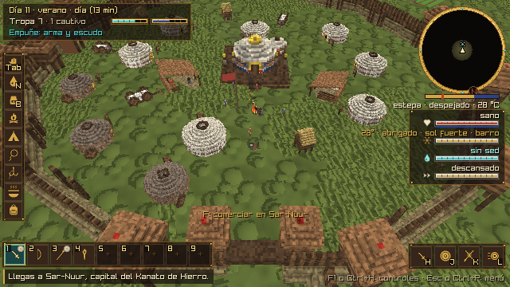 | 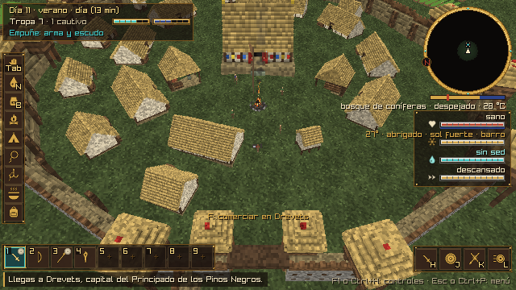 |
| **Estepa:** Sar-Nuur, la capital del kanato: la orda sobre su tarima, yurtas y carretas. | **Bosque:** casas de postes y paja, y la sala larga con sus escudos. |
| 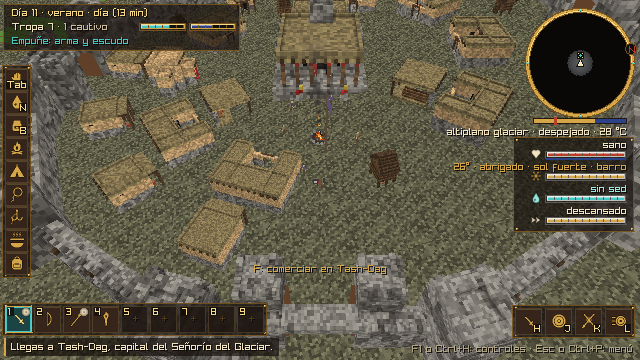 | 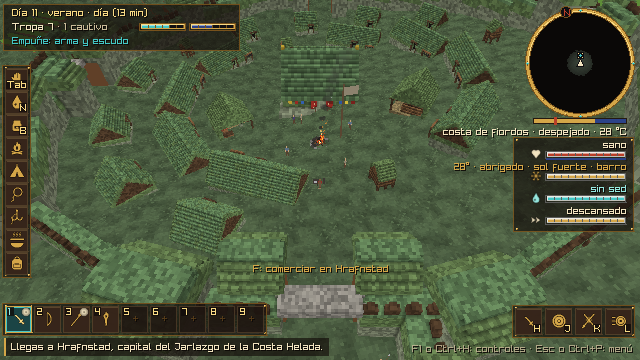 |
| **Altiplano:** casas de piedra y adobe de techo plano, y la sala de columnas sobre su terraza. | **Fiordos:** casas largas de turba y la sala larga. |
| 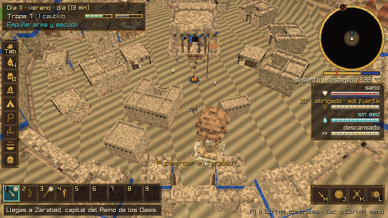 | 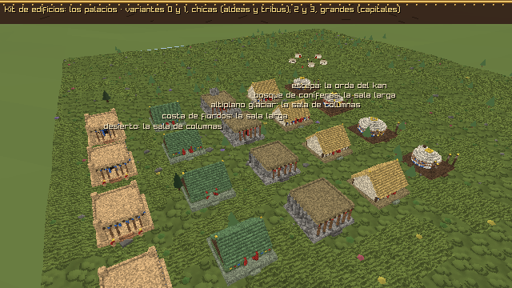 |
| **Desierto:** casas de adobe con patio y la sala de columnas con sus torres. | **Los palacios** de las cinco regiones (`--edificios palacio`). |

## La muralla, las ruinas y las obras de la tribu (v0.10.2)

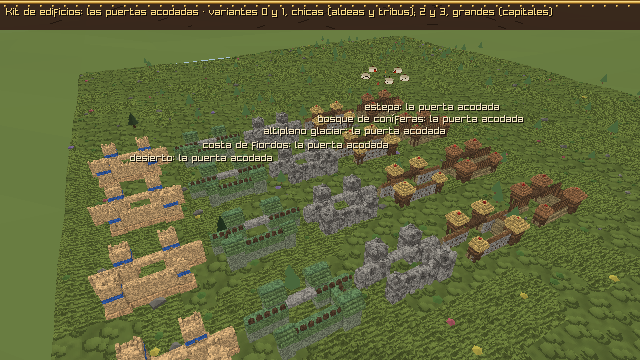

**La muralla de las capitales** sale del kit, con el perfil de su región. Lo que se ve es lo que
choca (`src/sim/army.h`): el adarve a la altura que se trepa, el hueco de la puerta y el antemuro.

| Región | El muro | Las torres |
|---|---|---|
| Estepa | Un terraplén de tierra con la empalizada de troncos encima | De troncos: cuatro postes, la garita de tablas con saeteras y el techo de cuero en punta |
| Bosque | El *murus gallicus*: la cara de piedra con las cabezas de las vigas, la tierra detrás y el parapeto de troncos | De troncos, con el techo de paja |
| Altiplano | Piedra, con contrafuertes y almenas | De piedra, con almenas, la franja y las saeteras |
| Fiordos | Piedra seca abajo, turba arriba con su pasto y un parapeto de tablas | De piedra oscura, con el techo de turba |
| Desierto | Adobe sobre un zócalo de piedra, con almenas escalonadas | De adobe, con la franja azul |

- **Las piezas:** la torre de cada esquina, tres tramos entre dos torres (cada uno a la altura de su
  suelo, con una escalera de mano o una gárgola) y la puerta.
- **La puerta acodada:** delante de cada puerta, un antemuro a 5,5 m de la muralla, de 14 m de largo,
  cerrado de un costado y con una torre en cada punta. Se entra por la boca, a lo largo de la
  muralla, y se dobla hacia la puerta: el que entra camina bajo el adarve y le da el flanco. Las
  torres de la puerta van a los lados del paso, y el adarve cruza por encima en un puente. Las
  puertas pares cierran el antemuro hacia un lado y las impares hacia el otro.
- **Por dónde se camina:** la muralla y los antemuros cortan el paso del jugador (que se desliza a lo
  largo), de las flechas y de los enemigos. Los enemigos y la guarnición buscan el camino más corto
  (`city_route`) por un grafo chico: el camino de cada puerta (rodear el antemuro, la boca, el patio y
  adentro), de puerta a puerta por adentro y, por afuera, de torre en torre. Cruzan la muralla solo
  por el medio de una puerta y pasan lejos de las puntas de los antemuros.

**Las ruinas** de los sitios del mundo se arman con las mismas piezas y después pasa el tiempo:
- **Lo alto cae primero:** cada columna pierde lo de arriba hasta una altura que da el ruido, y nada
  queda en el aire.
- **Lo caído** se amontona al pie de los muros (de tierra, piedra o adobe, según la región).
- **Encima** crece el pasto, el musgo o la arena.

Hay dos ruinas, cada una con cuatro variantes:
- **La fortaleza derruida:** un recinto cuadrado de 18 a 22 m con la muralla de su región, sus cuatro
  torres rotas y la puerta al frente; adentro, los cimientos de la sala del fondo y el pozo.
- **La ciudad enterrada** (del desierto): dos hileras de casas de adobe a los lados de la calle (unas
  con su cúpula, otras con lo que queda del techo de caña) y dos columnas del templo. La arena las
  tapa en dunas hasta la mitad.

**Las obras de la tribu** (las de `Tab` → Obras y las viviendas del campamento) se dibujan con el kit
mientras no tengan un modelo importado, a la medida de su objeto del inventario (`bk_for_item`).
Van al estilo de la estepa, porque la tribu es nómada:
- **Las obras:**
  - el refugio de ramas y pieles;
  - la empalizada y el muro de piedra seca;
  - el horno de cocina y los hornos de fundición del bronce y del acero;
  - la atalaya y el corral de cuerdas y estacas;
  - el taller del herrero.
- **Las viviendas:** la tienda ligera y la choza de fieltro. La casa de adobe (del desierto), la
  cabaña de troncos (del bosque) y la yurta del jefe van a su tamaño.
- **Lo que queda de ellas:** los escombros, el muro en ruinas, las cenizas y la yurta quemada.
- En cuanto llega el modelo de una (la tubería de modelos, `tools/modelos`), se usa el modelo.

| | |
|---|---|
| 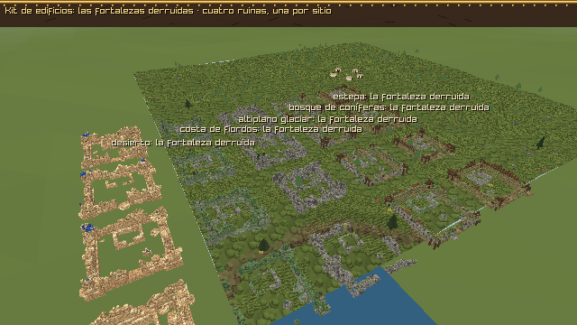 | 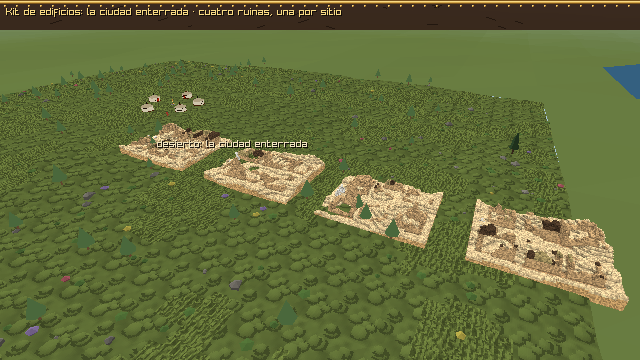 |
| **Las fortalezas derruidas** de las cinco regiones (`--edificios fortaleza`). | **La ciudad enterrada** (`--edificios enterrada`). |
| 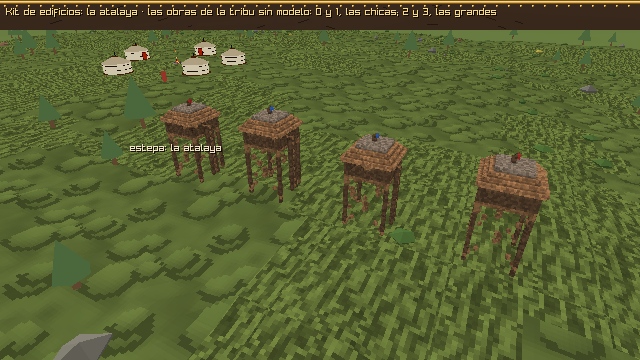 | 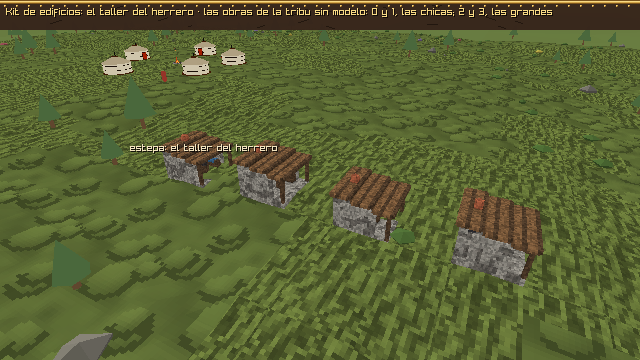 |
| **La atalaya** (`--edificios atalaya`). | **El taller del herrero** (`--edificios taller`). |
| 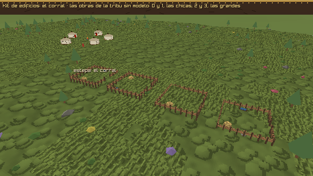 | 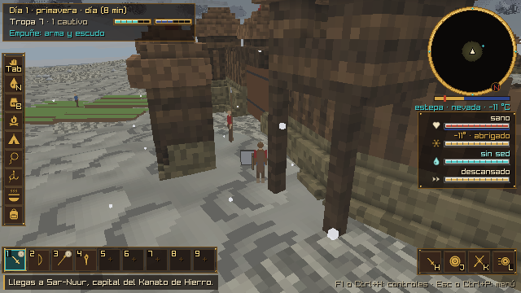 |
| **El corral** (`--edificios corral`). | **La puerta acodada** desde el patio del antemuro (`--asedio puerta`). |

**Para mirarlo:**
- `--edificios` con muralla, torre, puerta, fortaleza, enterrada, refugio, empalizada, muro, horno,
  horno_fundicion, atalaya, corral, taller, tienda, escombros o cenizas. Lo que es de una sola región
  (la ciudad enterrada y las obras de la tribu) se ve en una fila.
- `--ver <id>` muestra una obra de cerca, como en el juego.
- `--asedio puerta` y `--asedio salida` muestran la puerta acodada en el asedio.

## Fuentes

- Yurta: [National Geographic, *yurt*](https://education.nationalgeographic.org/resource/yurt/);
  [notas de construcción](https://www.simplydifferently.org/Yurt_Notes?page=1);
  [preguntas frecuentes](https://theoutfactory.com/mongolian-yurts-ger-faqs).
- Carretas: [Hipócrates, *Sobre los aires, aguas y lugares*](https://www.chlt.org/hippocrates/Adams/page.37.a.php);
  [Penn Museum, *Herodotus and the Scythians*](https://www.penn.museum/sites/expedition/herodotus-and-the-scythians/);
  [Schurmann 1982, Pazyryk](https://ia800204.us.archive.org/26/items/ThePazyrykItsUseAndOrigin/Schurmann_1982_Pazyryk.pdf).
- Kurganes: [world-archaeology.com, Arzhan](https://world-archaeology.com/features/arzhan);
  [UNESCO, lista tentativa](https://whc.unesco.org/en/tentativelists/6283/);
  [British Museum, *Scythians, ice mummies and burial mounds*](https://britishmuseum.org/blog/scythians-ice-mummies-and-burial-mounds);
  [Minpaku, SES 32](https://minpaku.repo.nii.ac.jp/record/3102/files/SES32_003.pdf).
- Estelas de ciervo: [Smithsonian, Deer Stone Project](https://mci.si.edu/joint-mongolian-smithsonian-deer-stone-project-hovsgol-aimag-mongolia);
  [The Past, *Conjuring Mongolian deer stones*](https://the-past.com/feature/conjuring-mongolian-deer-stones-biographical-statuary-of-bronze-age-central-asia-and-south-siberia).
- Bactria y Sogdiana: [Encyclopaedia Iranica](https://www.iranicaonline.org/?p=45108);
  [Encyclopaedia Iranica, arquitectura de Asia Central](https://www.iranicaonline.org/?p=9585);
  [*The Archaeology of Sogdiana*](https://edspace.american.edu/silkroadjournal/wp-content/uploads/sites/984/2017/09/The-Archaeology-of-Sogdiana.pdf);
  [McChesney, materiales de construcción](https://academics.hamilton.edu/central-asian-history/mcchesney-building-materials);
  [UNESCO, arte kushán](https://ar.unesco.org/silkroad/sites/default/files/knowledge-bank-article/vol_II%20silk%20road_kushan%20art%20BIS.pdf).
- Urartu: [Teishebaini](https://en.wikipedia.org/wiki/Teishebaini);
  [Arquitectura de Urartu](https://en.wikipedia.org/wiki/Architecture_of_Urartu);
  [Altıntepe](https://kureansiklopedi.com/en/cocuk-detay/altintepe-castle-erzincan-22ab1).
- Hallstatt y La Tène: [Heuneburg](https://en.wikipedia.org/wiki/Heuneburg);
  [*Heuneburg, first city north of the Alps*](https://www.world-archaeology.com/features/heuneburg-first-city-north-of-the-alps/);
  [*Pfostenschlitzmauer* y *murus gallicus*](https://en.wikipedia.org/wiki/Pfostenschlitzmauer);
  [*The Murus Gallicus of Basilia*](https://www.swiss-spectator.ch/?p=27169).
- Casas redondas: [Roundhouse](https://en.wikipedia.org/wiki/Roundhouse_(dwelling));
  [Butser, Maiden Castle](https://butser.org.uk/maidencastle.html);
  [Butser, Moel y Gerddi](https://butser.org.uk/moelygerddi.html).
- Casas largas: [Museum Silkeborg](https://museumsilkeborg.dk/living-conditions);
  [Hurstwic, *longhouse*](https://hurstwic.org/history/articles/daily_living/text/longhouse.htm);
  [UiO, *Archaeology of dwelling*](https://khm.uio.no/english/research/previous-projects/archaeology-of-dwelling).
- Hornos de cuba: [EXARC Journal](https://exarc.net/ark:/88735/10041);
  [Wareham Forge, *Get Iron*](https://www.warehamforge.ca/ironsmelting/Get-Iron.pdf).
- Graneros: [Butser, estructuras de la edad del hierro](https://butser.org.uk/iastructures.html);
  [Gallica, *Granary*](https://gallica.co.uk/buildings/grannary.htm).
- Templos del fuego: [Livius, Tepe Nush-e Jan](https://livius.org/articles/place/tepe-nush-e-jan);
  [Noushijan](https://en.wikipedia.org/wiki/Noushijan).
