# Capturas: las pantallas del juego desde su menú

Todas a 640x360, la resolución real del juego (en pantalla se escala con píxeles nítidos). Se regeneran con:

```bash
tools/capturas.sh          # usa build/; necesita xvfb-run en Linux
```

Los menús usan **iconos** (siluetas del atlas [`assets/ui/iconos.png`](../assets/ui/iconos.png), editable: ver [ESTILO_VISUAL.md](ESTILO_VISUAL.md#iconos)). El nombre de cada botón aparece, discreto, en la **leyenda de la base de la pantalla** al pasar el ratón (o el dedo) por encima, o al elegirlo con el teclado.

## Entrada

| | |
|---|---|
| 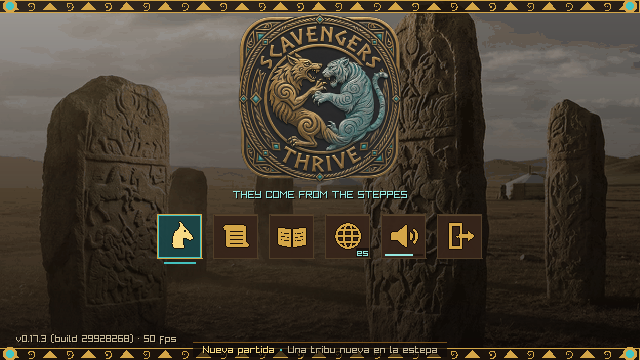 | **Título** (`--menu`): nueva partida, cargar, instructivo, salir. |
| 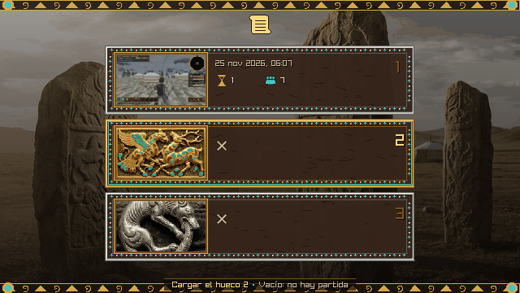 | **Cargar partida** (`--huecos`): tres huecos con minifoto, fecha, día y tribu. |
| 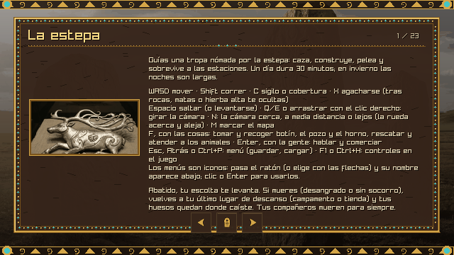 | **Instructivo** (`--instructivo`): láminas con las reglas; botones de página anterior, volver y siguiente. |

## En la partida

| | |
|---|---|
| 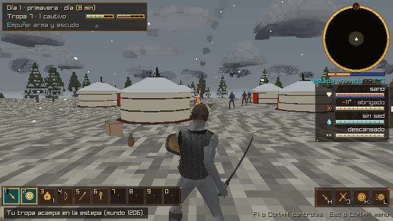 | **El juego**: la cámara cerca, detrás del personaje (`N`: media o lejos), el HUD compacto, la brújula, el clima y la salud. |
| 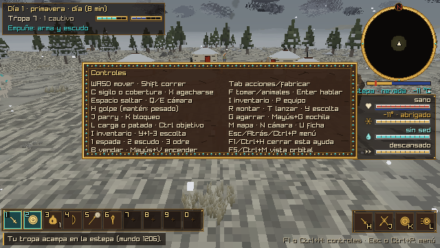 | **Controles** (F1, `--controles`). |
| 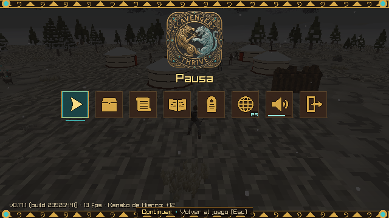 | **Pausa** (Esc, `--pausa`): continuar, guardar, cargar, instructivo, al título, salir. |
| 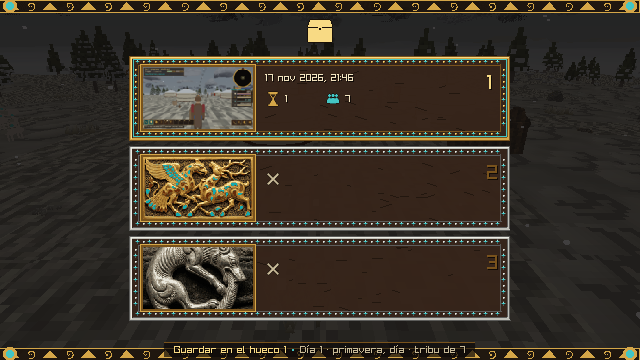 | **Guardar** (`--guardar`): la minifoto es la partida al pausar. |

## Menú de acciones (L): acciones, obras, fabricar, reparar

| | |
|---|---|
| 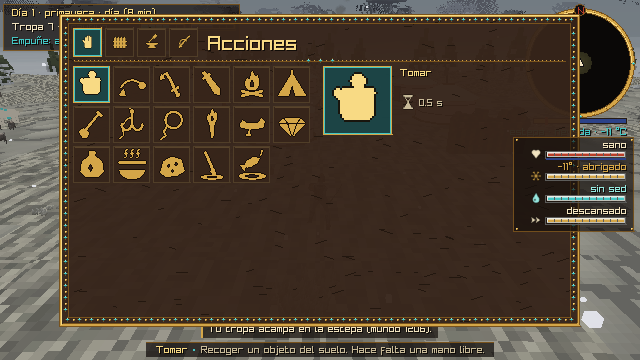 | **Acciones** (`--pestana 0`). |
| 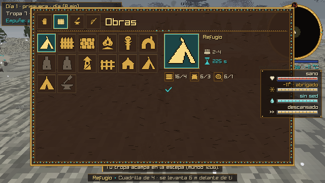 | **Obras en grupo** (`--pestana 1`): las grises no se pueden aún (falta oficio o cuadrilla). |
| 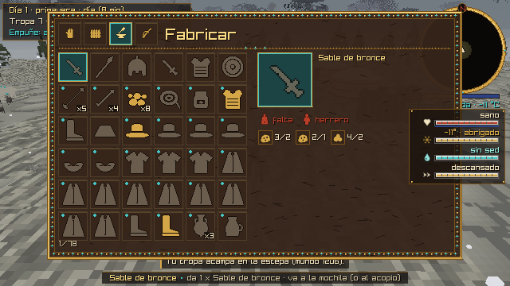 | **Fabricar** (`--pestana 2`): punto turquesa = a mano; los ingredientes, como iconos con lo que tienes / lo que hace falta. |
| 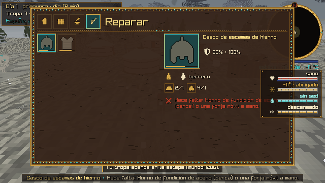 | **Reparar** (`--pestana 3`): la barra al pie es el estado de la pieza. |

## Inventario y equipo

| | |
|---|---|
| 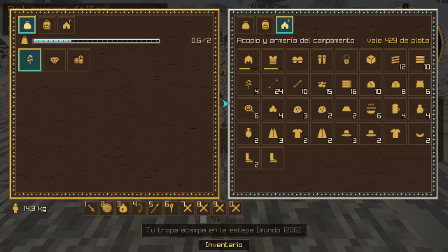 | **Inventario** (Tab, `--inventario`): dos columnas; arriba, los contenedores a mano (bolsillos, mochila, alforjas, carreta, campamento). |
| 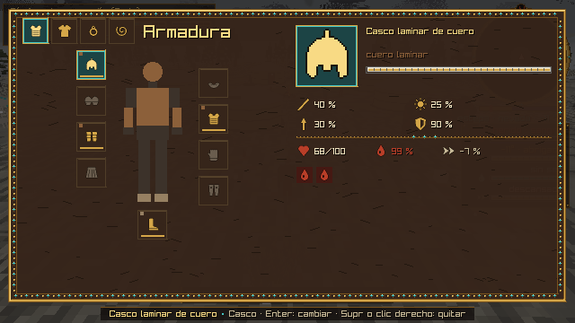 | **Equipo** (P, `--equipo`): los nueve huecos de armadura alrededor de la figura y los tres amuletos; a la derecha, sus cifras y la salud. |

### El equipo puesto (v0.17.1)

El del patrón del usuario, en el cuerpo común (`assets/models/README.md`, «El equipo de los humanoides: el patrón»). Los cascos, cada uno en la cabeza del maniquí y de tres cuartos (`--ver armadura.casco.<nombre> --desde tres_cuartos`): el montaje, [`capturas/los_cascos.png`](capturas/los_cascos.png). Siete van donde los colocó el usuario en sus referencias (`arte/fuentes/patron/cascos_colocados.glb`); el culto, que no tiene referencia, con la regla que sale de ellas (`assets/models/README.md`, «Cascos»).

| | |
|---|---|
| 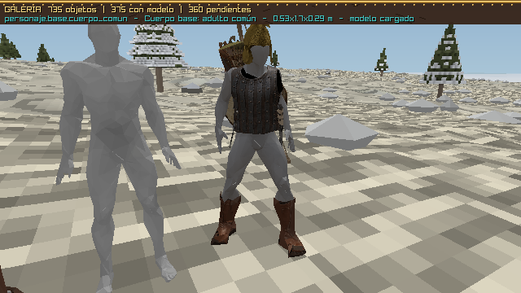 | **Guardado** (`--ver personaje.base.cuerpo_comun --patron guardado`): la coraza y las botas con el cuerpo, el casco en la cabeza, el escudo, la aljaba y el arco a la espalda, y el sable y la daga al costado. |
| 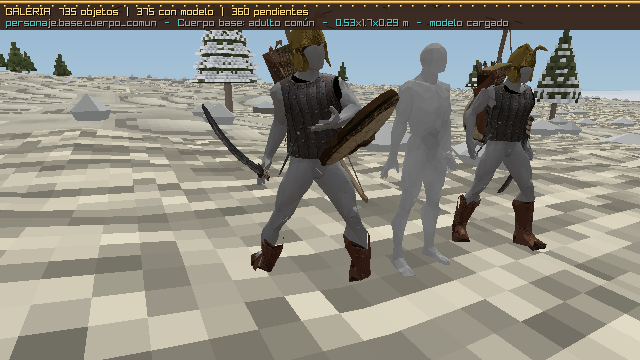 | **Empuñado** (`--patron empunado`): el sable en la mano derecha y el escudo en el antebrazo. |
| 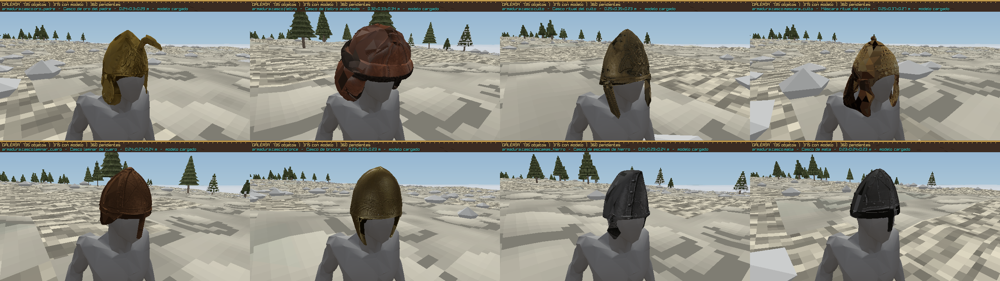 | **Los ocho cascos**, puestos: el oro del padre, el fieltro, el culto y la máscara del culto (arriba); el laminar de cuero, el bronce, las escamas de hierro y la malla (abajo). |

## Combate y mundo

| | |
|---|---|
|  | **Jinetes bandidos** (`--enemigos jinetes`): sentados en la silla de su caballo estepario (v0.17.3). |
| 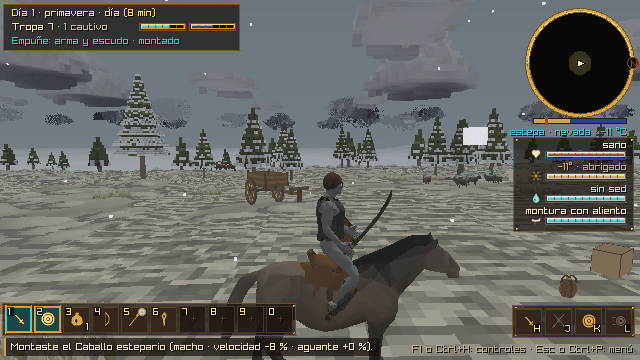 | **A caballo** (`--montado quieto --giro-camara 90`): el jugador sentado en la silla, con los pies en los estribos y las manos en las riendas (v0.17.3). |
| 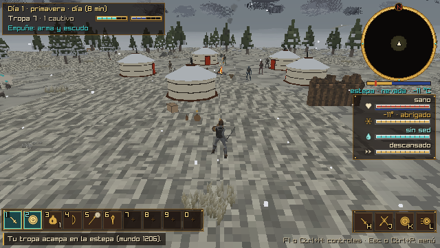 | **Bolsas de botín** (`--botin`). |
| 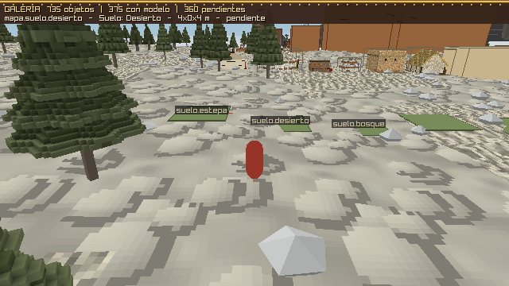 | **Galería de modelos** (`--galeria`): todos los objetos del inventario a escala. |

### Las manos

Los cuatro botones (`H J K L`, abajo a la derecha) según lo que está fuera; la espada y el escudo se guardan por separado (`1` y `2`, [PLAN_TACTICO_Y_CUEVAS.md](PLAN_TACTICO_Y_CUEVAS.md), A1). El montaje: [`capturas/las_manos.png`](capturas/las_manos.png).

| | |
|---|---|
| 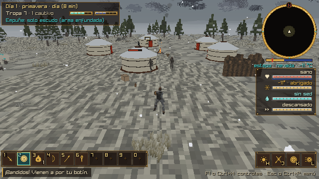 | **El escudo solo** (`--enemigos bandidos --manos escudo`): la espada al cinto; puñetazo, parry con el escudo, cubrirse y carga. |
| 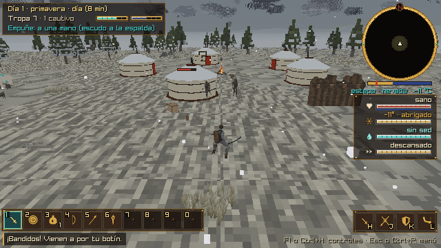 | **La espada sola** (`--manos espada`): el escudo a la espalda; golpe, parry, parar con el arma y patada. |
| 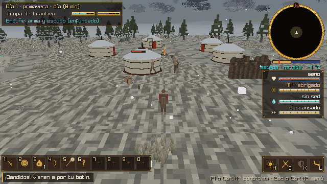 | **Todo guardado** (`--manos nada`): puñetazo, la llave y patada; sin bloqueo. |
| 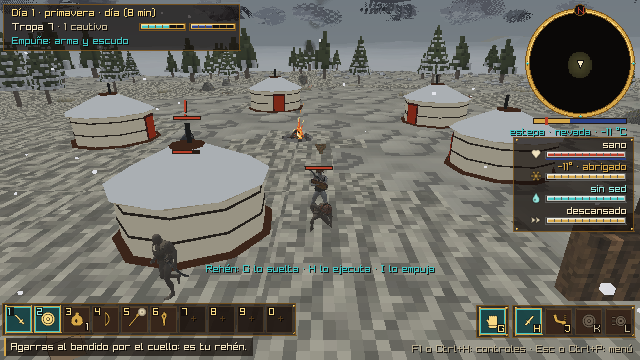 | **Con un rehén** (`--enemigos bandidos --rehen`): `H` lo ejecuta, `J` lo empuja, `G` lo suelta. |

### La guardia, la lanza y el último aliento (v0.17.4)

Los arreglos del combate: la guardia que se sostiene y se cansa, la lanza ligera aparte del escudo (la casilla `5`) y lo que pasa al quedarse sin vida. El montaje: [`capturas/el_combate.png`](capturas/el_combate.png).

| | |
|---|---|
| 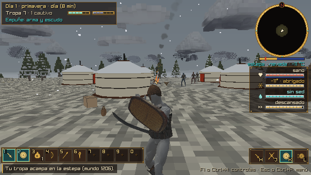 | **La guardia** (`--tecla k 30 200`, `K` mantenida): el escudo en alto delante del pecho, de frente, mientras se sostiene la tecla. |
| 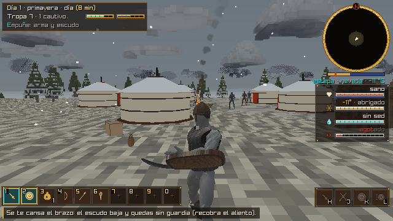 | **La guardia que cae** (`--aguante 0.01 --tecla k 21 400`): sin aguante el brazo cede, el escudo baja y `K` queda en gris hasta recobrar el aliento. |
| 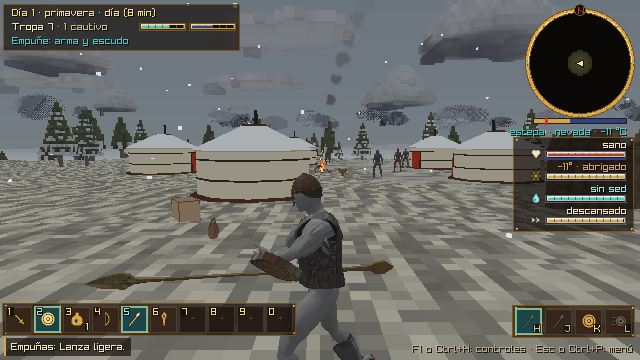 | **La estocada** (`--usar-casilla 5 20 --tecla h 60 2`): la lanza en la mano derecha, sin tocar el escudo, golpea de punta. |
| 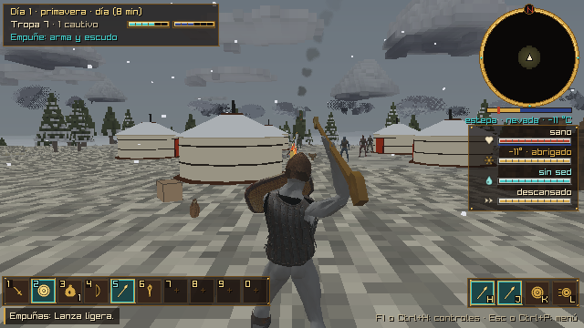 | **Arrojar la lanza** (`--usar-casilla 5 20 --tecla j 40 60`): mantener `J` la levanta sobre el hombro y apunta con la cámara; al soltar, vuela. |
| 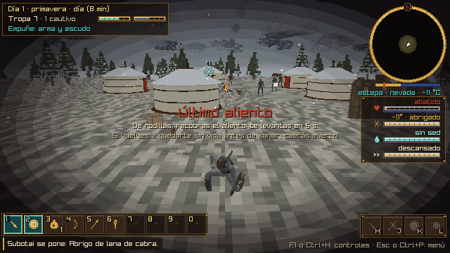 | **El último aliento** (`--ultimo-aliento rodillas`): de rodillas, con la cuenta para levantarse y el halo oscuro. |
| 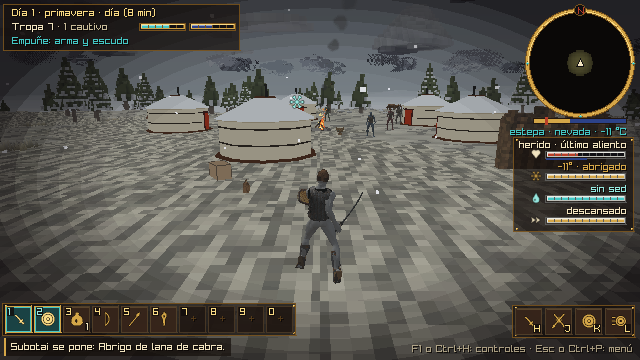 | **En pie, con la vista en túnel** (`--ultimo-aliento en_pie`): «último aliento» en la salud hasta sanar; si cae otra vez antes, muere. |

### La barra, el objetivo y la cobertura

El resto del sistema táctico ([PLAN_TACTICO_Y_CUEVAS.md](PLAN_TACTICO_Y_CUEVAS.md), A2 a A4):

| | |
|---|---|
| 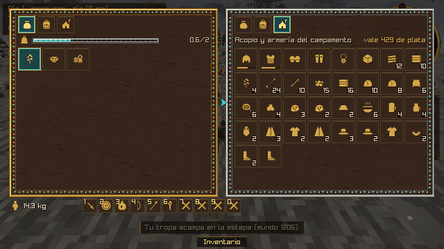 | **La barra rápida desde el inventario** (`--inventario`): abajo, la fila de las diez casillas (`1` a `0`); un número, o un toque en la fila, pone ahí lo elegido. |
| 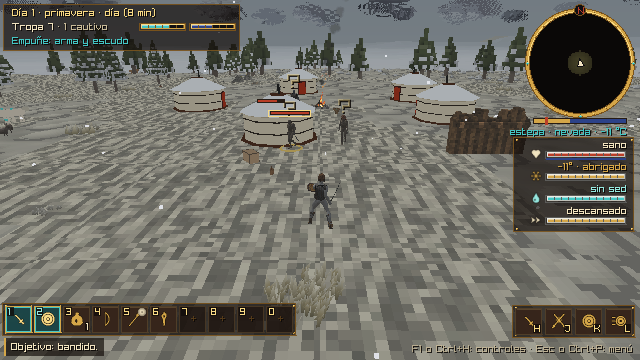 | **El objetivo** (`--enemigos bandidos --objetivo`, como pulsar `O`): el elegido lleva la barra de vida con marco dorado. |
| 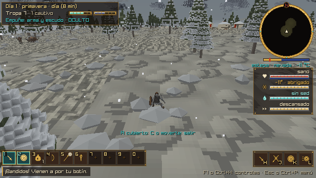 | **A cubierto** (`--cubierto --enemigos bandidos`): `C` junto a una roca del mundo; «OCULTO» arriba y lo que se puede hacer al pie. |

## Las cuevas

Una por guarida ([PLAN_TACTICO_Y_CUEVAS.md](PLAN_TACTICO_Y_CUEVAS.md), B1 a B3, y [PLAN_CUEVAS_GRANDES.md](PLAN_CUEVAS_GRANDES.md)). Con `--ir boca-<tipo>` (afuera), `--explorar` (F en la boca) y
`--cueva tipo[:lugar]` (adentro; `--antorcha`, encendida; `--cueva-f`, como pulsar F). Los montajes:
[`capturas/las_cuevas.png`](capturas/las_cuevas.png) y, cada tipo por dentro,
[`capturas/cuevas_por_tipo.png`](capturas/cuevas_por_tipo.png).

| | |
|---|---|
| 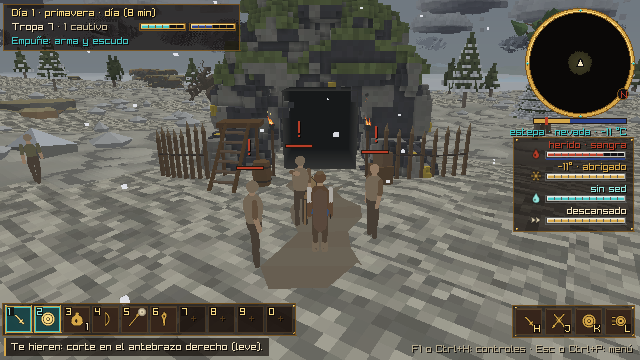 | **La boca de un refugio de forajidos** (`--ir boca-forajidos`): la roca de voxeles con su arco y su túnel, las antorchas, la escalera al saliente y la estacada; sus guardias salen a pelear. |
| 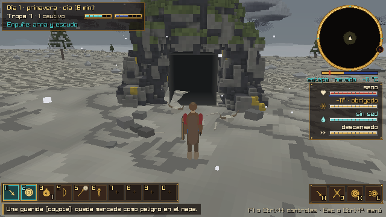 | **La boca de una guarida de fieras** (`--ir boca-animal`): la roca sola, con su arco natural, el liquen y el pasto en lo alto, y las dos rocas bajas del umbral. |
| 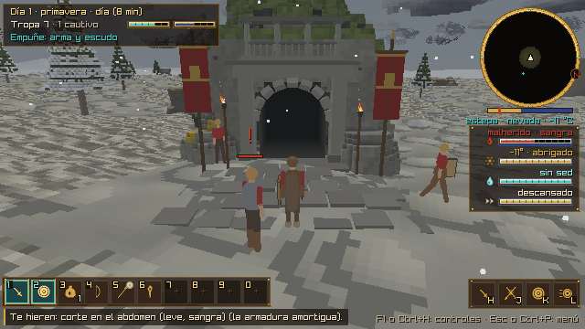 | **La boca de un almacén del imperio** (`--ir boca-imperio`): el saliente de piedra con su baranda, los estandartes y la guardia imperial. |
| 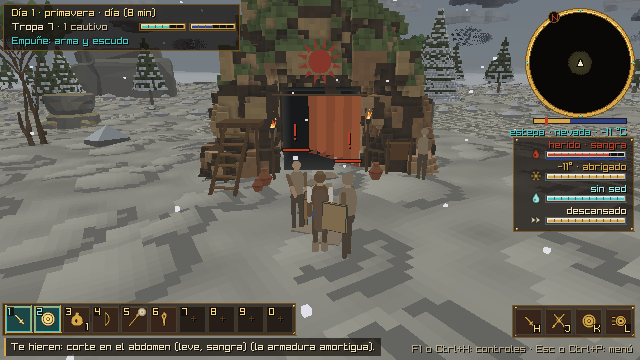 | **La boca de un refugio de una tribu** (`--ir boca-tribu`): la cortina de cuero corrida, el sol pintado sobre el arco y el bastidor con un cuero. |
| 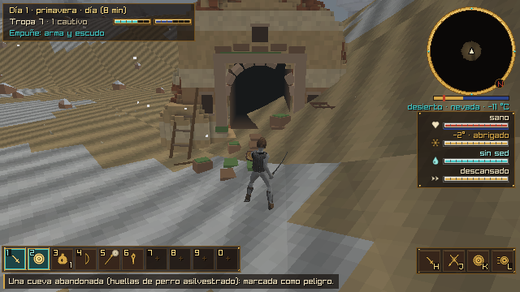 | **La boca de una cueva abandonada** (`--ir boca-abandonada`): en el desierto, la arenisca en estratos; la fachada de una civilización desaparecida (jambas, dintel, nichos y hornacina), la escalera rota y la reja caída a un costado. |
| 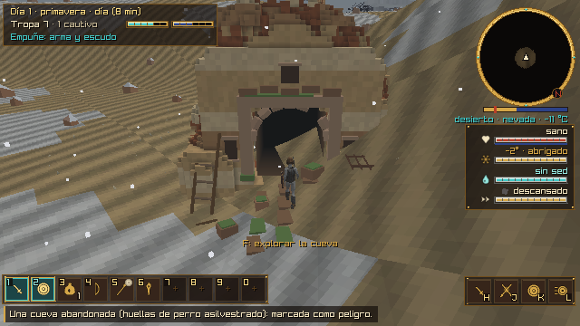 | **Junto a la boca, F explora** (`--ir boca-abandonada --caminar adelante`; con `--explorar`, como si se pulsara): el aviso «F: explorar la cueva». La cueva se carga aparte, con «Explorando la cueva...» en pantalla. |
| 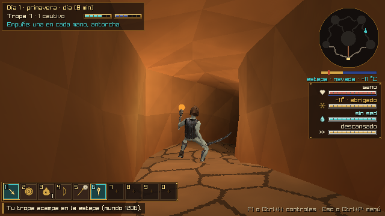 | **Un pasillo con sus vueltas** (`--cueva tribu:pasillo3 --antorcha`): de 10 m o más, alumbrado por la antorcha, en la roca ocre y lisa de la tribu. |
| 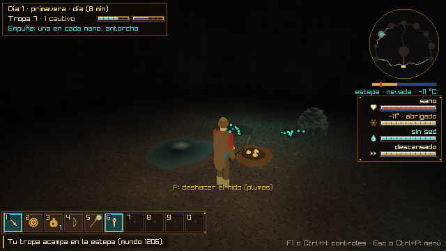 | **Adentro de una guarida de fieras** (`--cueva animal:nido --antorcha`): el nido con sus huevos, un charco y los hongos que brillan, sobre la grava mojada. |
| 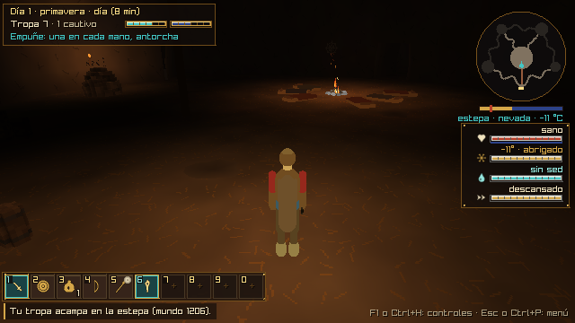 | **La Cisterna de los forajidos** (`--cueva forajidos:0 --antorcha`): a lo lejos, la fogata con sus jergones; la sala, de unos 15 m de radio, se pierde en lo oscuro más allá de la luz. |
| 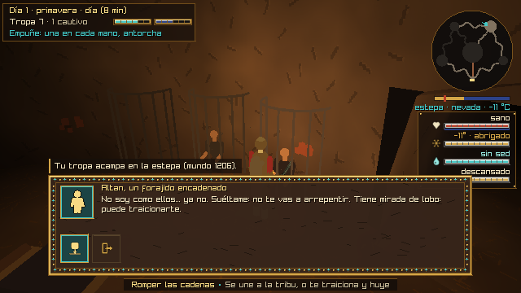 | **Un prisionero** (`--cueva forajidos:dialogo`): lo que dice, si se lo ve sincero, y romper las cadenas o dejarlo. |
| 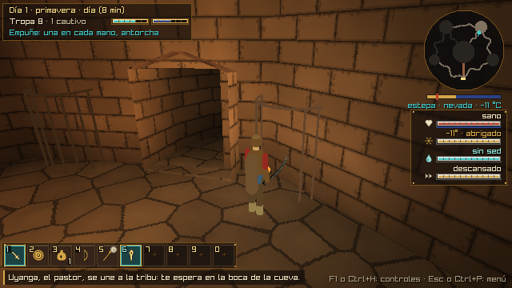 | **Se une a la tribu** (`--cueva imperio:dialogo --cueva-f`): la tropa pasa de 7 a 8 y la celda queda abierta. |
| 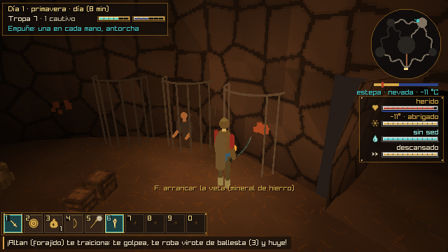 | **Te traiciona** (`--cueva forajidos:dialogo --cueva-f`): te golpea, te roba tres virotes y huye. |
| 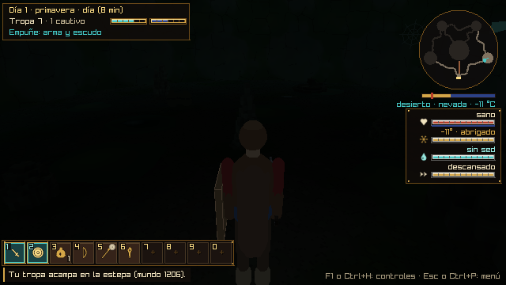 | **Una recámara a oscuras** (`--cueva abandonada:1`): sin antorcha se ve apenas alrededor. |
| 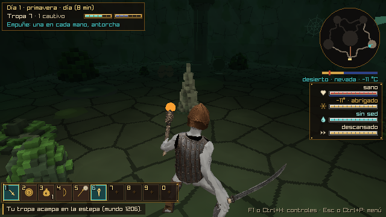 | **La misma, con la antorcha** (`--antorcha`): una estalagmita de voxeles y una roca del decorado. |
| 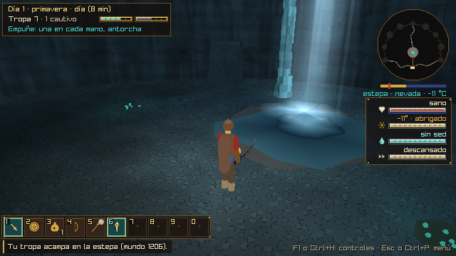 | **Una guarida de fieras por dentro** (`--cueva animal:poza --antorcha`): el lago de la Cisterna, huesos y los hongos que brillan; la caliza gris azulada y la bruma azul. |
| 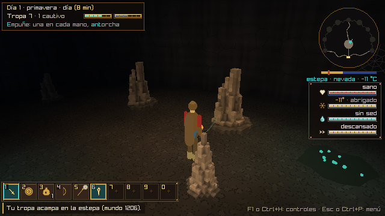 | **Los racimos de estalagmitas** (`--cueva animal:estalagmitas --antorcha`): sobre su colada, junto a la pared. |
| 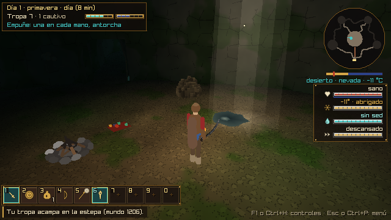 | **Una cueva abandonada** (`--cueva abandonada:claraboya --antorcha`): la luz del día entra por el agujero de la bóveda, con su polvo; el musgo, un charco, el botín y la niebla verde. |
| 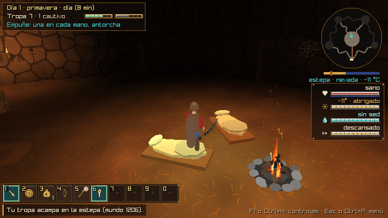 | **Un refugio de forajidos** (`--cueva forajidos:jergon --antorcha`): los jergones alrededor de la fogata, la tierra con paja y, en la pared, las rayas de conteo. |
|  | **El refugio de una tribu** (`--cueva tribu:alfombra --antorcha`): las alfombras de fieltro y un jergón junto al hogar, sobre la tierra roja. |
|  | **Las pinturas de la tribu** (`--cueva tribu:pintura --antorcha`): manos en negativo y cazadores con un ciervo. |
|  | **El salón de un almacén del imperio** (`--cueva imperio:0 --antorcha --dron 9 --camara 0.35`): los braseros en ronda, las columnas y las losas, entre muros de sillares. |
|  | **Un túnel labrado** (`--cueva imperio:pasillo2 --antorcha`): sillares, la bóveda de cañón de ladrillo y el suelo de losas. |

## El mundo

Ver [MUNDO.md](MUNDO.md). Con `--ir lugar` y `--orbital`:

| | |
|---|---|
|  | **Vista orbital** (F5, `--orbital 30 0.5`): el gran círculo con sus cinco regiones, el canal, el mar y el muro; torres doradas: capitales; blancas: aldeas; rojas: guaridas; turquesa: el jugador. |
|  | **Bosque de coníferas** (`--ir bosque`): los pinos y los arces de voxeles (v0.14.1); con la cámara lejana, la copa que tapa al personaje no se dibuja. |
|  | **Altiplano glaciar** (`--ir altiplano`). |
|  | **Costa de fiordos y el mar** (`--ir mar`). |
|  | **El arrecife** (`--ir arrecife`, v0.17.0): junto a la playa, el agua clara deja ver el pasto marino y las algas; más allá, el mar hondo se oscurece como una niebla. |
|  | **De la estepa al bosque** (`--ir linde-bosque`, v0.17.0): en manchas, bosquecillos y claros. |
|  | **De la estepa al desierto** (`--ir linde-desierto`, v0.17.0): el pasto y las matas, secos, sin flores. |
|  | **La frontera del bosque con el desierto** (`--ir bosque-seco`, v0.17.0): los árboles secos y muertos, sobre el suelo pajizo. |
|  | **El cañón y el muro del desierto** (`--ir muro`): los estratos de los badlands, en franjas que siguen la altura (v0.14.2). |
|  | **El muro del cañón entero** (`--ir panorama-muro`, a 520 m): promontorios, cárcavas en V y agujas en el filo; de lejos, las mismas franjas (la rampa de la malla lejana). |
|  | **El frente del glaciar** (`--ir hielo`): una pared casi a pique en columnas, con grietas azules y bloques de hielo caídos al pie (v0.14.2). |
|  | **El muro de hielo entero** (`--ir panorama-hielo`, a 520 m). |
|  | **El gran canal** (`--ir canal`). |
|  | **Una capital** (`--ir capital`): la del Principado de los Pinos Negros. |
|  | **Una aldea** del desierto (`--ir aldea`). |
|  | **Una guarida** (`--ir guarida`). |
|  | **Un lago** (`--ir lago`): el más grande fuera del bosque, del otro lado de su desborde ([AGUA.md](AGUA.md)). |
|  | **El desborde de un lago** (`--ir desborde`): por ahí sale su río. |
|  | **Una cascada** (`--ir cascada`): la más grande tierra adentro, desde abajo. |
|  | **El pie del glaciar** (`--ir lengua`): la morrena, lo más bajo junto al muro de hielo. |

### Las estaciones del agua

El mismo lugar en dos momentos del año ([AGUA.md](AGUA.md), fase 2), con `--dia` (la primavera empieza el día 1;
el verano, el 8; el otoño, el 15; el invierno, el 22):

| | |
|---|---|
|  | **Un río del glaciar** (`--dia 17 --ir meandro`): todavía con agua. |
|  | **El mismo, seco** (`--dia 20`): con la helada, el glaciar no suelta agua y queda el cauce de cantos. |
|  | **Un lago glaciar** (`--dia 21 --ir lago --dron 30`): los grandes se hielan después que los chicos. |
|  | **El mismo, helado** (`--dia 25`). |
|  | **El mar al romperse su hielo** (`--dia 5 --ir mar`): el hielo de la costa y los témpanos a la deriva. |
|  | **El mar helado en la costa** (`--dia 26`). |
|  | **La lengua del glaciar** (`--dia 6 --ir lengua`): cubre la morrena. |
|  | **La morrena en el verano** (`--dia 9`): el glaciar se retiró. |

### Hielo, nado y pesca

La tribu en el agua y la pesca en el hielo ([AGUA.md](AGUA.md), fase 3), con `--trampa`:

| | |
|---|---|
|  | **La escolta cruza un río a nado** (`--dia 11 --ir meandro --trampa nado`): con la cabeza afuera, hacia el jugador en la orilla. |
|  | **Y sale a la orilla** (el mismo, unos segundos después). |
|  | **Un compañero rompió el hielo** (`--dia 25 --ir lago --trampa hundido`): espera, con la cabeza afuera, a que lo saquen (F). |
|  | **El agujero para pescar** (`--dia 25 --ir lago --trampa agujero`): abierto con el picahielo sobre el lago helado. |

### Cómo se ve el agua

El shader del agua ([AGUA.md](AGUA.md), fase 4), en verano (`--dia 11`):

| | |
|---|---|
|  | **La corriente de un río** (`--ir meandro --trampa nado`): la superficie avanza aguas abajo, y quien nada lleva su anillo de espuma. |
|  | **Las olas del mar en las rocas** (`--ir mar --dron 6 --camara 0.45`): el oleaje, y la espuma que va y viene en la costa y el basalto. |
|  | **Un lago glaciar** (`--ir desborde`): el vaivén, las ondas que se cruzan y la espuma fina de la orilla. |
|  | **Los rápidos de un arroyo** (`--ir rapidos`): la corriente y la espuma en lo bajo, entre los cantos. |
|  | **Una cascada de cerca** (`--ir cascada-pie`): la cortina que baja, la espuma y la bruma al pie. |
|  | **El agua sin su shader** (`--sin-shader`): lo que queda si el teléfono no lo compila (las ondas y la malla de espuma de antes). |

### Los bordes

El muro tras el canal del bosque y el mar abierto ([AGUA.md](AGUA.md), fase 5):

| | |
|---|---|
|  | **El muro de roca del otro lado del canal** (`--ir muro-canal`): estratos levantados, desde la orilla despejada. |
|  | **El mismo, desde arriba del bosque** (`--ir canal --dron 45`). |
|  | **La aleta del tiburón** (`--ir mar --trampa tiburon`): da vueltas alrededor de quien nada mar adentro de su línea. |
|  | **Despertar en la playa** (`--ir mar --trampa mordida`): herido y con secuelas («herido · secuelas»). |

## Los edificios de la edad del hierro

Ver [ARQUITECTURA_EDAD_DEL_HIERRO.md](ARQUITECTURA_EDAD_DEL_HIERRO.md). Con `--edificios tipo[:región]`
(una fila por región, las cuatro variantes de cada una) y `--ir plaza-<región> --dron 40 --camara 0.85`:

| | |
|---|---|
|  | **Las casas** (`--edificios casa`): la yurta, la casa de postes y paja, la de piedra y adobe, la casa larga de turba y la de adobe con patio. |
|  | **Los palacios** (`--edificios palacio`): la orda del kan, las salas largas y las salas de columnas. |
|  | **Las fundiciones** (`--edificios fundicion`): el horno de cuba bajo el cobertizo de cada región. |
|  | **Los cuarteles** (`--edificios cuartel`), con su armero de lanzas. |
|  | **Las carpinterías** (`--edificios carpinteria`). |
|  | **Los graneros** (`--edificios granero`): sobre postes, o de adobe con silos. |
|  | **Los templos del fuego** (`--edificios templo`), del desierto y el altiplano. |
|  | **Las carretas-casa** de la estepa (`--edificios carreta`). |
|  | **Los tramos de la muralla** (`--edificios muralla`): el terraplén con la empalizada, el *murus gallicus*, la piedra con contrafuertes, la piedra seca y la turba, el adobe sobre zócalo. |
|  | **Las torres de la muralla** (`--edificios torre`). |
|  | **Las puertas acodadas** (`--edificios puerta`): el antemuro, cerrado de un costado. |
|  | **La puerta acodada en el asedio** (`--asedio puerta`): desde el patio del antemuro, mirando la puerta. |
|  | **La guarnición sale** por la puerta acodada (`--asedio salida`). |
|  | **Las fortalezas derruidas** (`--edificios fortaleza`): la muralla de cada región, comida desde arriba; las grandes, con el torreón de tres pisos y torres en ruinas en las esquinas; las chicas, una torre sola (v0.14.2). |
|  | **La ciudad enterrada** del desierto (`--edificios enterrada`): las casas de ladrillo de adobe trabado, en dunas. |
|  | **El ladrillo de la ciudad enterrada, de cerca** (`--edificios enterrada --dron 24`): cada hilada corrida media pieza, la junta oscura. |
|  | **Las formaciones del desierto** (`--formaciones desierto`): farallones, hongos y arcos de arenisca y la creta. |
|  | **Las formaciones del hielo** (`--formaciones hielo`): los bloques caídos del glaciar y los témpanos. |
|  | **El refugio de ramas y pieles** (`--edificios refugio`), una obra de la tribu. |
|  | **La empalizada** (`--edificios empalizada`). |
|  | **El muro de piedra seca** (`--edificios muro`). |
|  | **El horno de cocina** (`--edificios horno`). |
|  | **Los hornos de fundición** del bronce y del acero (`--edificios horno_fundicion`). |
|  | **La atalaya** (`--edificios atalaya`). |
|  | **El corral** de cuerdas y estacas (`--edificios corral`). |
|  | **El taller del herrero** (`--edificios taller`). |
|  | **La tienda ligera y la choza de fieltro** (`--edificios tienda`). |
|  | **Los escombros y el muro en ruinas** (`--edificios escombros`). |
|  | **Las cenizas y la yurta quemada** (`--edificios cenizas`). |
|  | **Los asentamientos antiguos**: las cuatro plantas de cada región, con los muros casi a ras del suelo (`--edificios asentamiento`; los tramos de pie, en el mundo: `--ir asentamiento`). |
|  | **La capital del kanato** (`--ir plaza-estepa`). |
|  | **La capital del bosque** (`--ir plaza-bosque`). |
|  | **La capital del altiplano** (`--ir plaza-altiplano`). |
|  | **La capital de los fiordos** (`--ir plaza-fiordos`). |
|  | **La capital del desierto** (`--ir plaza-desierto`). |
