# Capturas: las pantallas del juego desde su menú

Todas a 640x360, la resolución real del juego (en pantalla se escala con píxeles nítidos). Se regeneran con:

```bash
tools/capturas.sh          # usa build/; necesita xvfb-run en Linux
```

Los menús usan **iconos** (siluetas del atlas [`assets/ui/iconos.png`](../assets/ui/iconos.png), editable: ver [ESTILO_VISUAL.md](ESTILO_VISUAL.md#iconos)). El nombre de cada botón aparece, discreto, en la **leyenda de la base de la pantalla** al pasar el ratón (o el dedo) por encima, o al elegirlo con el teclado.

## Entrada

| | |
|---|---|
| 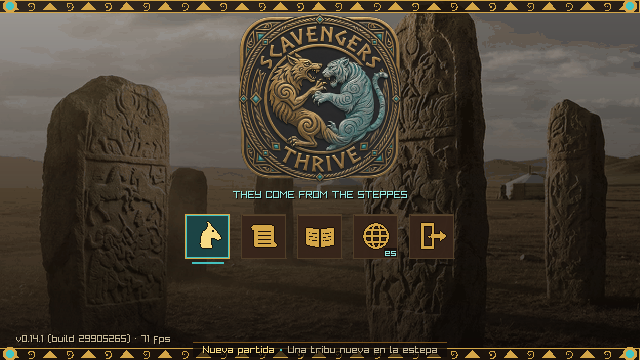 | **Título** (`--menu`): nueva partida, cargar, instructivo, salir. |
| 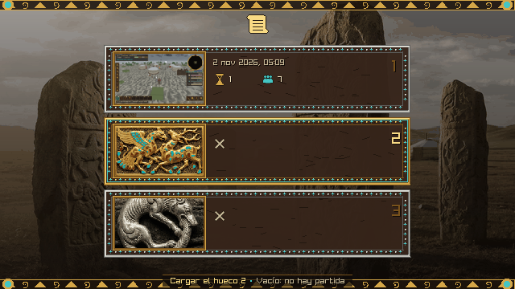 | **Cargar partida** (`--huecos`): tres huecos con minifoto, fecha, día y tribu. |
| 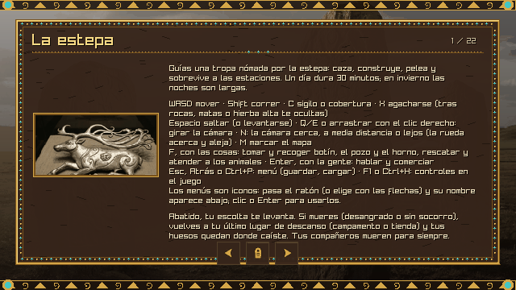 | **Instructivo** (`--instructivo`): láminas con las reglas; botones de página anterior, volver y siguiente. |

## En la partida

| | |
|---|---|
| 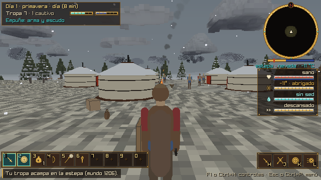 | **El juego**: HUD compacto, brújula, clima y salud. |
| 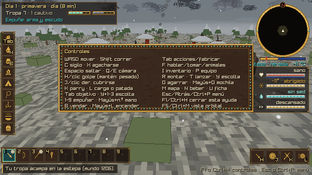 | **Controles** (F1, `--controles`). |
| 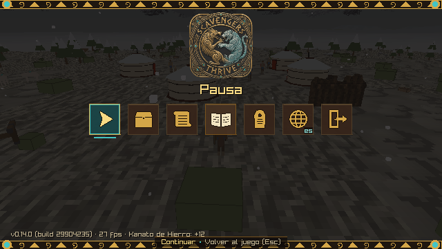 | **Pausa** (Esc, `--pausa`): continuar, guardar, cargar, instructivo, al título, salir. |
| 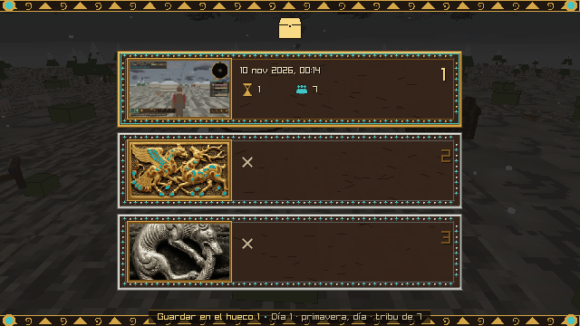 | **Guardar** (`--guardar`): la minifoto es la partida al pausar. |

## Menú de acciones (L): acciones, obras, fabricar, reparar

| | |
|---|---|
| 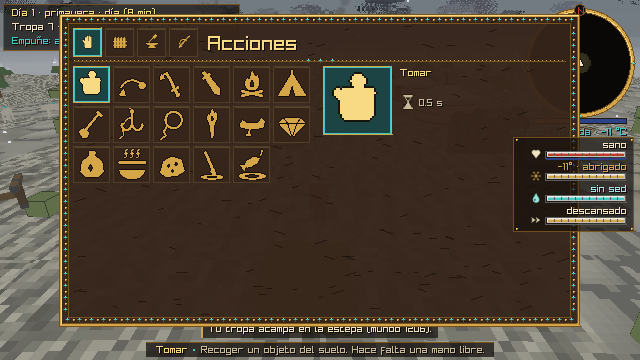 | **Acciones** (`--pestana 0`). |
| 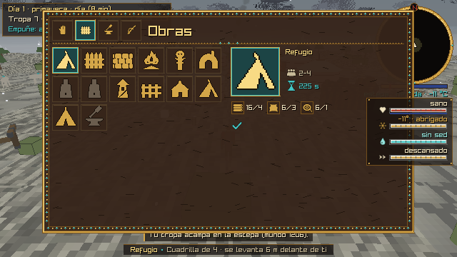 | **Obras en grupo** (`--pestana 1`): las grises no se pueden aún (falta oficio o cuadrilla). |
| 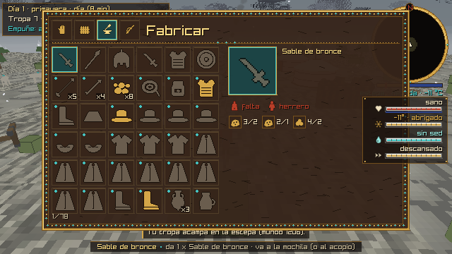 | **Fabricar** (`--pestana 2`): punto turquesa = a mano; los ingredientes, como iconos con lo que tienes / lo que hace falta. |
| 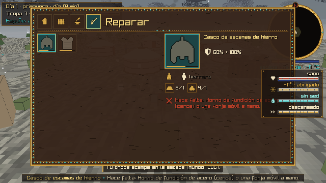 | **Reparar** (`--pestana 3`): la barra al pie es el estado de la pieza. |

## Inventario y equipo

| | |
|---|---|
|  | **Inventario** (Tab, `--inventario`): dos columnas; arriba, los contenedores a mano (bolsillos, mochila, alforjas, carreta, campamento). |
| 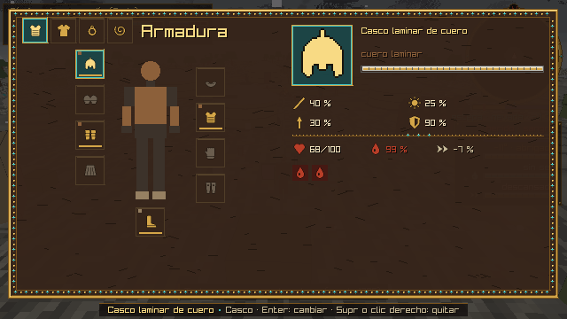 | **Equipo** (P, `--equipo`): los nueve huecos de armadura alrededor de la figura y los tres amuletos; a la derecha, sus cifras y la salud. |

## Combate y mundo

| | |
|---|---|
| 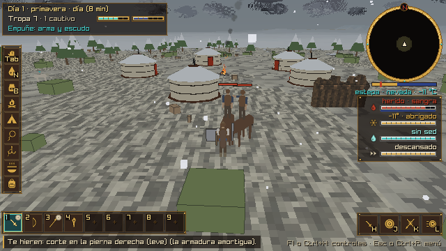 | **Jinetes bandidos** (`--enemigos jinetes`). |
| 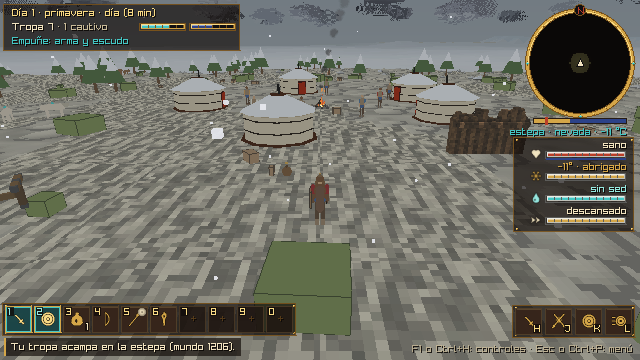 | **Bolsas de botín** (`--botin`). |
| 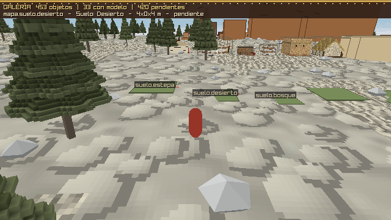 | **Galería de modelos** (`--galeria`): todos los objetos del inventario a escala. |

### Las manos

Los cuatro botones (`H I J K`, abajo a la derecha) según lo que está fuera; la espada y el escudo se guardan por separado (`1` y `2`, [PLAN_TACTICO_Y_CUEVAS.md](PLAN_TACTICO_Y_CUEVAS.md), A1). El montaje: [`capturas/las_manos.png`](capturas/las_manos.png).

| | |
|---|---|
| 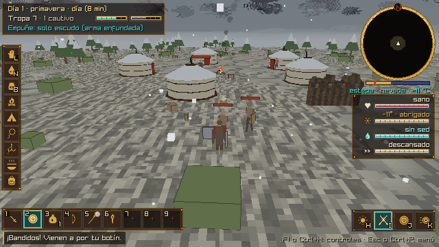 | **El escudo solo** (`--enemigos bandidos --manos escudo`): la espada al cinto; puñetazo, parry con el escudo, cubrirse y carga. |
| 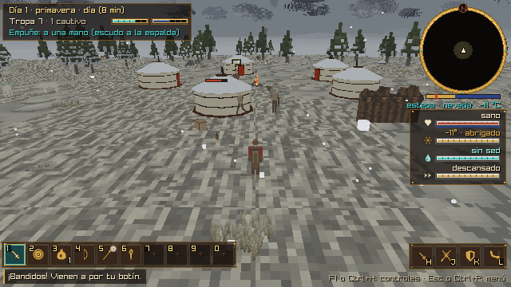 | **La espada sola** (`--manos espada`): el escudo a la espalda; golpe, parry, parar con el arma y patada. |
| 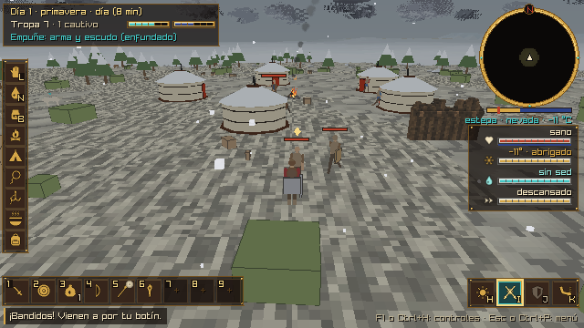 | **Todo guardado** (`--manos nada`): puñetazo, la llave y patada; sin bloqueo. |
| 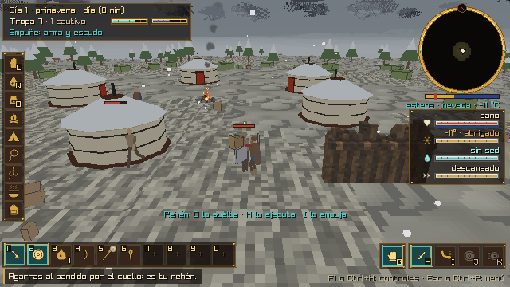 | **Con un rehén** (`--enemigos bandidos --rehen`): `H` lo ejecuta, `I` lo empuja, `G` lo suelta. |

### La barra, el objetivo y la cobertura

El resto del sistema táctico ([PLAN_TACTICO_Y_CUEVAS.md](PLAN_TACTICO_Y_CUEVAS.md), A2 a A4):

| | |
|---|---|
| 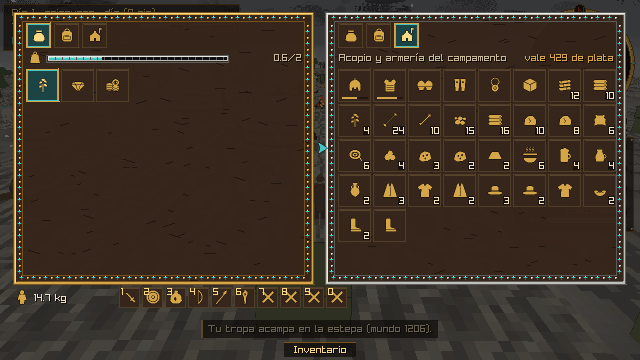 | **La barra rápida desde el inventario** (`--inventario`): abajo, la fila de las diez casillas (`1` a `0`); un número, o un toque en la fila, pone ahí lo elegido. |
| 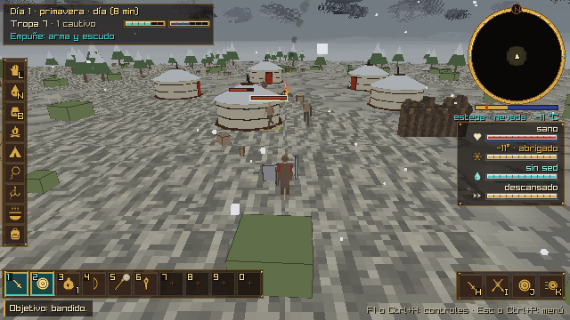 | **El objetivo** (`--enemigos bandidos --objetivo`, como pulsar `O`): el elegido lleva la barra de vida con marco dorado. |
| 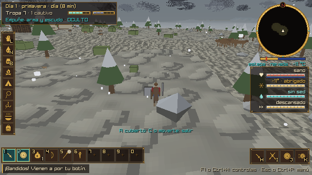 | **A cubierto** (`--cubierto --enemigos bandidos`): `C` junto a una roca del mundo; «OCULTO» arriba y lo que se puede hacer al pie. |

## Las cuevas

Una por guarida ([PLAN_TACTICO_Y_CUEVAS.md](PLAN_TACTICO_Y_CUEVAS.md), B1 a B3). Con `--ir boca-<tipo>` (afuera) y
`--cueva tipo[:lugar]` (adentro; `--antorcha`, encendida; `--cueva-f`, como pulsar F). El montaje:
[`capturas/las_cuevas.png`](capturas/las_cuevas.png).

| | |
|---|---|
| 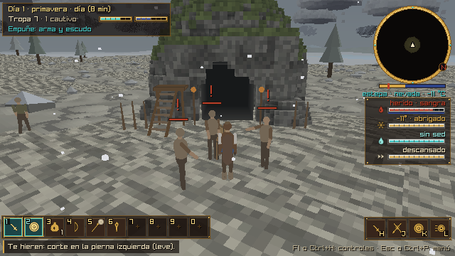 | **La boca de un refugio de forajidos** (`--ir boca-forajidos`): el peñasco, el túnel, las antorchas y la estacada; sus guardias salen a pelear. |
| 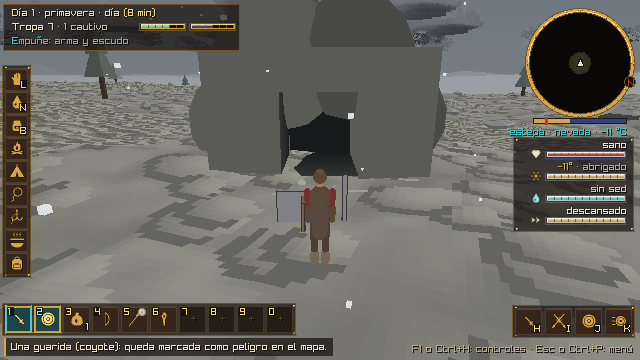 | **La boca de una guarida de fieras** (`--ir boca-animal`). |
| 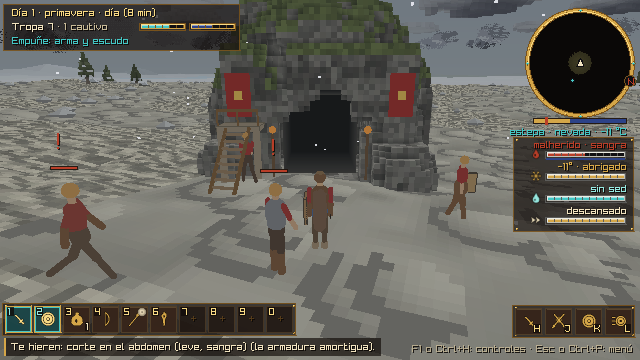 | **La boca de un almacén del imperio** (`--ir boca-imperio`): piedra labrada, estandartes y la guardia imperial. |
| 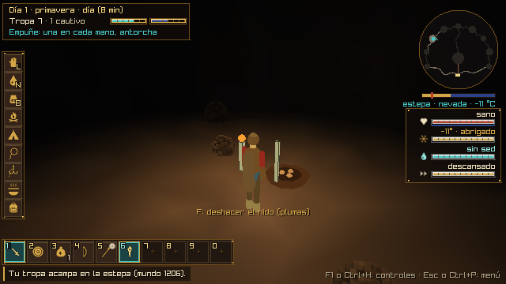 | **Adentro de una guarida de fieras** (`--cueva animal:nido --antorcha`): el nido con sus huevos, a la luz de la antorcha. |
| 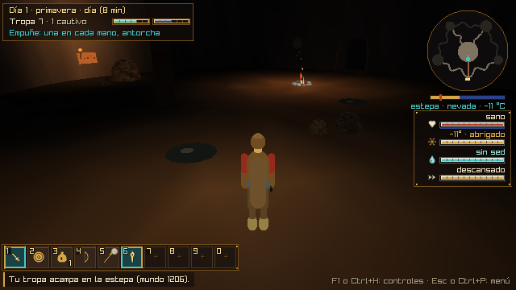 | **La Cisterna de los forajidos** (`--cueva forajidos:0 --antorcha`): la fogata, la columna de ladrillo, las pinturas y su antorcha, una telaraña y los charcos. |
| 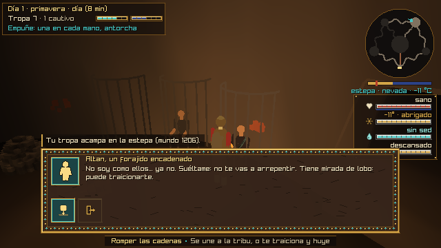 | **Un prisionero** (`--cueva forajidos:dialogo`): lo que dice, si se lo ve sincero, y romper las cadenas o dejarlo. |
| 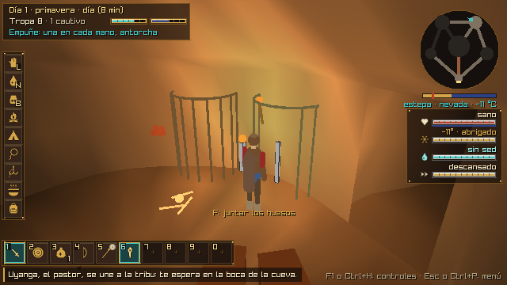 | **Se une a la tribu** (`--cueva imperio:dialogo --cueva-f`): la tropa pasa de 7 a 8 y la celda queda abierta. |
| 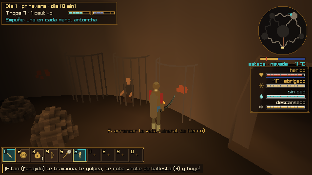 | **Te traiciona** (`--cueva forajidos:dialogo --cueva-f`): te golpea, te roba tres virotes y huye. |
| 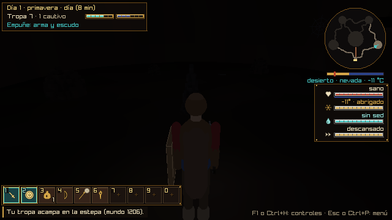 | **Una recámara a oscuras** (`--cueva abandonada:1`): sin antorcha se ve apenas alrededor. |
| 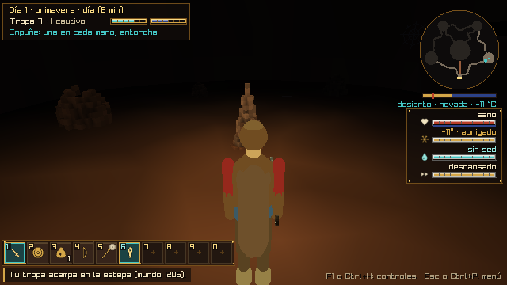 | **La misma, con la antorcha** (`--antorcha`). |

## El mundo

Ver [MUNDO.md](MUNDO.md). Con `--ir lugar` y `--orbital`:

| | |
|---|---|
| 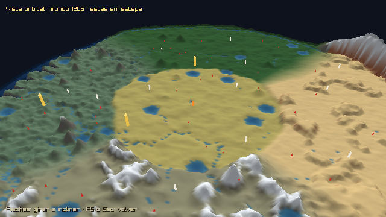 | **Vista orbital** (F5, `--orbital 30 0.5`): el gran círculo con sus cinco regiones, el canal, el mar y el muro; torres doradas: capitales; blancas: aldeas; rojas: guaridas; turquesa: el jugador. |
| 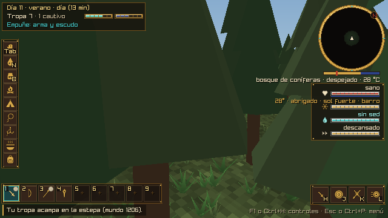 | **Bosque de coníferas** (`--ir bosque`). |
| 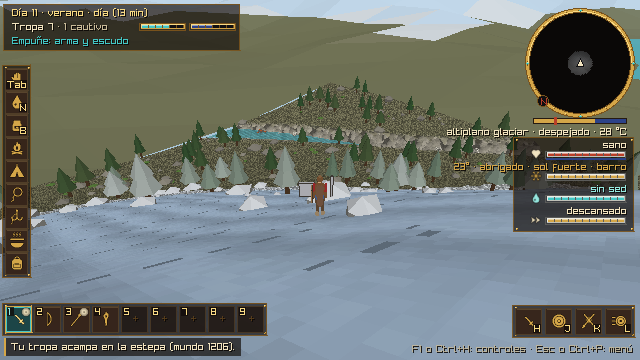 | **Altiplano glaciar** (`--ir altiplano`). |
| 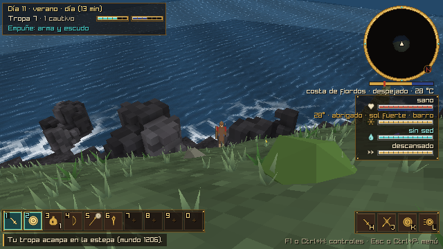 | **Costa de fiordos y el mar** (`--ir mar`). |
| 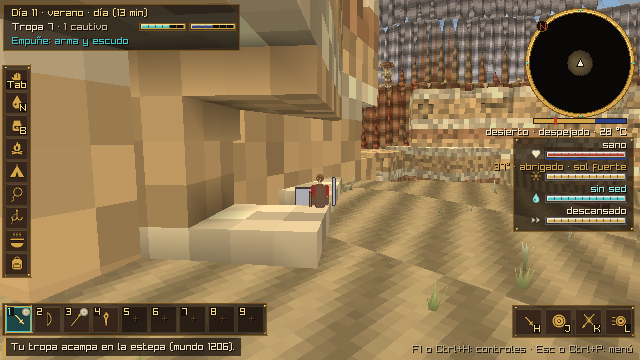 | **El cañón y el muro del desierto** (`--ir muro`). |
| 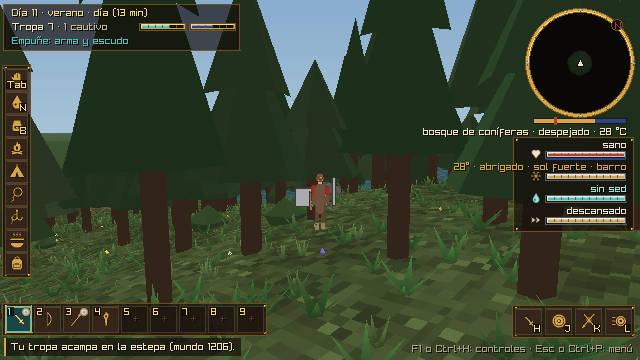 | **El gran canal** (`--ir canal`). |
| 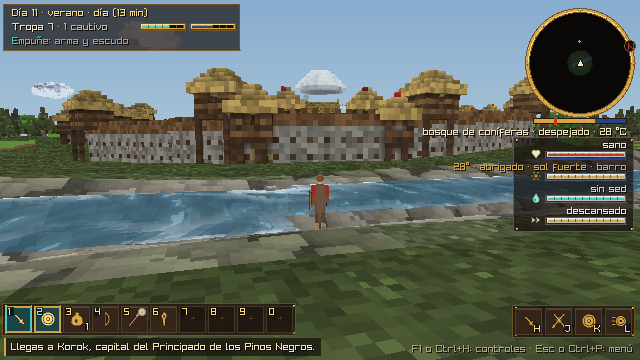 | **Una capital** (`--ir capital`): la del Principado de los Pinos Negros. |
| 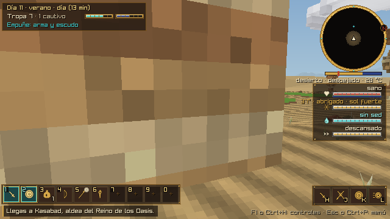 | **Una aldea** del desierto (`--ir aldea`). |
| 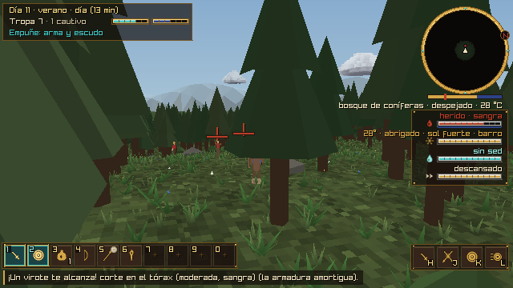 | **Una guarida** (`--ir guarida`). |
| 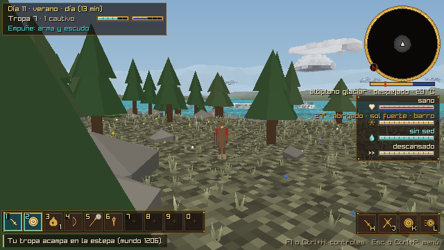 | **Un lago** (`--ir lago`): el más grande fuera del bosque, del otro lado de su desborde ([AGUA.md](AGUA.md)). |
| 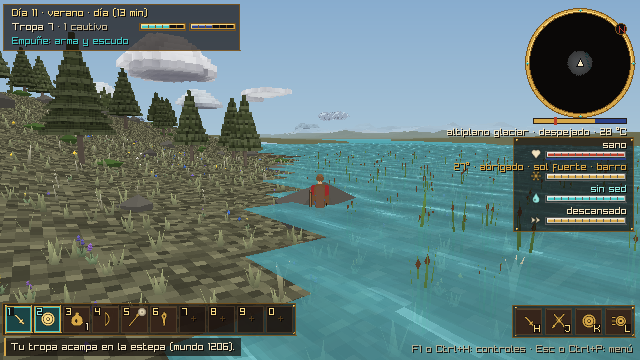 | **El desborde de un lago** (`--ir desborde`): por ahí sale su río. |
| 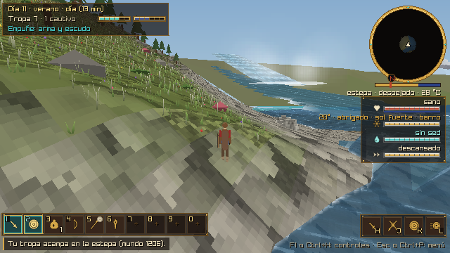 | **Una cascada** (`--ir cascada`): la más grande tierra adentro, desde abajo. |
| 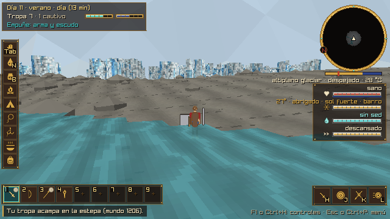 | **El pie del glaciar** (`--ir lengua`): la morrena, lo más bajo junto al muro de hielo. |

### Las estaciones del agua

El mismo lugar en dos momentos del año ([AGUA.md](AGUA.md), fase 2), con `--dia` (la primavera empieza el día 1;
el verano, el 8; el otoño, el 15; el invierno, el 22):

| | |
|---|---|
| 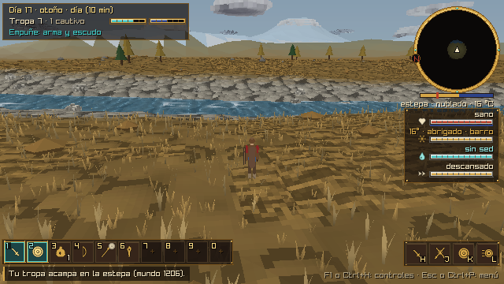 | **Un río del glaciar** (`--dia 17 --ir meandro`): todavía con agua. |
| 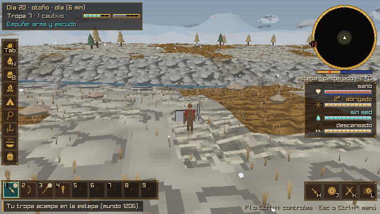 | **El mismo, seco** (`--dia 20`): con la helada, el glaciar no suelta agua y queda el cauce de cantos. |
| 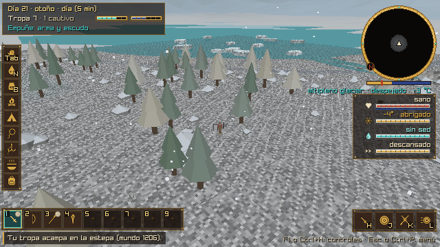 | **Un lago glaciar** (`--dia 21 --ir lago --dron 30`): los grandes se hielan después que los chicos. |
| 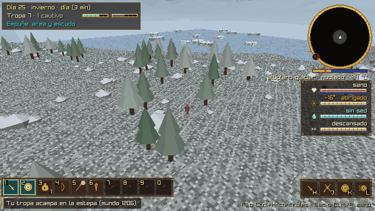 | **El mismo, helado** (`--dia 25`). |
| 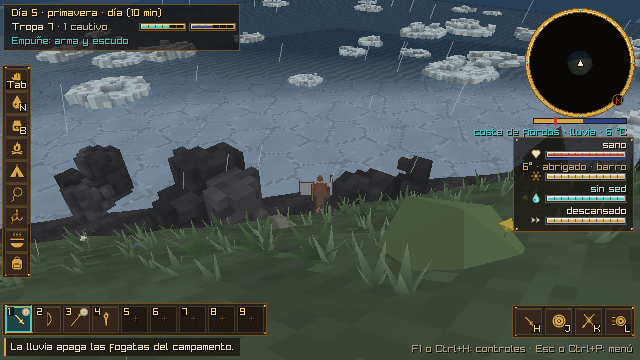 | **El mar al romperse su hielo** (`--dia 5 --ir mar`): el hielo de la costa y los témpanos a la deriva. |
|  | **El mar helado en la costa** (`--dia 26`). |
|  | **La lengua del glaciar** (`--dia 6 --ir lengua`): cubre la morrena. |
|  | **La morrena en el verano** (`--dia 9`): el glaciar se retiró. |

### Hielo, nado y pesca

La tribu en el agua y la pesca en el hielo ([AGUA.md](AGUA.md), fase 3), con `--trampa`:

| | |
|---|---|
|  | **La escolta cruza un río a nado** (`--dia 11 --ir meandro --trampa nado`): con la cabeza afuera, hacia el jugador en la orilla. |
|  | **Y sale a la orilla** (el mismo, unos segundos después). |
|  | **Un compañero rompió el hielo** (`--dia 25 --ir lago --trampa hundido`): espera, con la cabeza afuera, a que lo saquen (F). |
|  | **El agujero para pescar** (`--dia 25 --ir lago --trampa agujero`): abierto con el picahielo sobre el lago helado. |

### Cómo se ve el agua

El shader del agua ([AGUA.md](AGUA.md), fase 4), en verano (`--dia 11`):

| | |
|---|---|
|  | **La corriente de un río** (`--ir meandro --trampa nado`): la superficie avanza aguas abajo, y quien nada lleva su anillo de espuma. |
|  | **Las olas del mar en las rocas** (`--ir mar --dron 6 --camara 0.45`): el oleaje, y la espuma que va y viene en la costa y el basalto. |
|  | **Un lago glaciar** (`--ir desborde`): el vaivén, las ondas que se cruzan y la espuma fina de la orilla. |
|  | **Los rápidos de un arroyo** (`--ir rapidos`): la corriente y la espuma en lo bajo, entre los cantos. |
|  | **Una cascada de cerca** (`--ir cascada-pie`): la cortina que baja, la espuma y la bruma al pie. |
|  | **El agua sin su shader** (`--sin-shader`): lo que queda si el teléfono no lo compila (las ondas y la malla de espuma de antes). |

### Los bordes

El muro tras el canal del bosque y el mar abierto ([AGUA.md](AGUA.md), fase 5):

| | |
|---|---|
|  | **El muro de roca del otro lado del canal** (`--ir muro-canal`): estratos levantados, desde la orilla despejada. |
|  | **El mismo, desde arriba del bosque** (`--ir canal --dron 45`). |
|  | **La aleta del tiburón** (`--ir mar --trampa tiburon`): da vueltas alrededor de quien nada mar adentro de su línea. |
|  | **Despertar en la playa** (`--ir mar --trampa mordida`): herido y con secuelas («herido · secuelas»). |

## Los edificios de la edad del hierro

Ver [ARQUITECTURA_EDAD_DEL_HIERRO.md](ARQUITECTURA_EDAD_DEL_HIERRO.md). Con `--edificios tipo[:región]`
(una fila por región, las cuatro variantes de cada una) y `--ir plaza-<región> --dron 40 --camara 0.85`:

| | |
|---|---|
|  | **Las casas** (`--edificios casa`): la yurta, la casa de postes y paja, la de piedra y adobe, la casa larga de turba y la de adobe con patio. |
|  | **Los palacios** (`--edificios palacio`): la orda del kan, las salas largas y las salas de columnas. |
|  | **Las fundiciones** (`--edificios fundicion`): el horno de cuba bajo el cobertizo de cada región. |
|  | **Los cuarteles** (`--edificios cuartel`), con su armero de lanzas. |
|  | **Las carpinterías** (`--edificios carpinteria`). |
|  | **Los graneros** (`--edificios granero`): sobre postes, o de adobe con silos. |
|  | **Los templos del fuego** (`--edificios templo`), del desierto y el altiplano. |
|  | **Las carretas-casa** de la estepa (`--edificios carreta`). |
|  | **Los tramos de la muralla** (`--edificios muralla`): el terraplén con la empalizada, el *murus gallicus*, la piedra con contrafuertes, la piedra seca y la turba, el adobe sobre zócalo. |
|  | **Las torres de la muralla** (`--edificios torre`). |
|  | **Las puertas acodadas** (`--edificios puerta`): el antemuro, cerrado de un costado. |
|  | **La puerta acodada en el asedio** (`--asedio puerta`): desde el patio del antemuro, mirando la puerta. |
|  | **La guarnición sale** por la puerta acodada (`--asedio salida`). |
|  | **Las fortalezas derruidas** (`--edificios fortaleza`): la muralla de cada región, comida desde arriba. |
|  | **La ciudad enterrada** del desierto (`--edificios enterrada`). |
|  | **El refugio de ramas y pieles** (`--edificios refugio`), una obra de la tribu. |
|  | **La empalizada** (`--edificios empalizada`). |
|  | **El muro de piedra seca** (`--edificios muro`). |
|  | **El horno de cocina** (`--edificios horno`). |
|  | **Los hornos de fundición** del bronce y del acero (`--edificios horno_fundicion`). |
|  | **La atalaya** (`--edificios atalaya`). |
|  | **El corral** de cuerdas y estacas (`--edificios corral`). |
|  | **El taller del herrero** (`--edificios taller`). |
|  | **La tienda ligera y la choza de fieltro** (`--edificios tienda`). |
|  | **Los escombros y el muro en ruinas** (`--edificios escombros`). |
|  | **Las cenizas y la yurta quemada** (`--edificios cenizas`). |
|  | **La capital del kanato** (`--ir plaza-estepa`). |
|  | **La capital del bosque** (`--ir plaza-bosque`). |
|  | **La capital del altiplano** (`--ir plaza-altiplano`). |
|  | **La capital de los fiordos** (`--ir plaza-fiordos`). |
|  | **La capital del desierto** (`--ir plaza-desierto`). |
