# El mundo: reglas fijas y detalles al azar

El mundo es una **gran tierra casi redonda** de 4,8 km de radio medio. Su borde es **fractal**: tiene entrantes y salientes, no es una circunferencia neta. Cada partida nueva tira una **semilla**. Las reglas de abajo no cambian nunca; la semilla solo mueve los detalles. Todo sale de `src/sim/world.c` (C puro): la altura y el agua son funciones de (x, z) que consultan el terreno, la física, la fauna y los mapas.

El norte es −Z y el este +X.

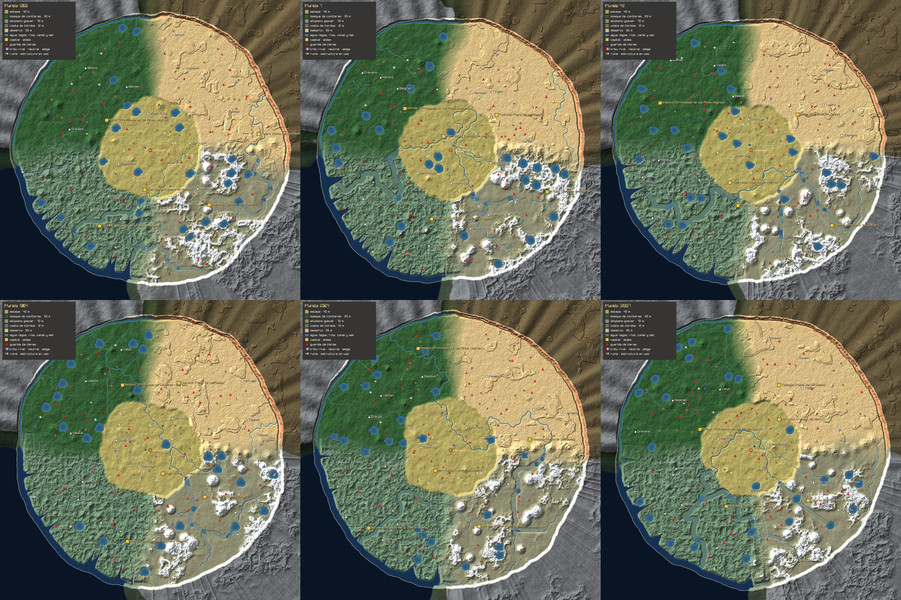

*Seis mundos (semillas 1206, 7, 42, 1984, 2024 y 31337) generados con las mismas reglas.*

## Reglas fijas

| Regla | Qué hace |
|---|---|
| **La estepa en el centro** | Allí acampa la tribu, en una loma suave (el agua baja alrededor, nunca por el campamento). La cruzan los ríos que bajan del altiplano hacia el bosque y la costa. |
| **Cuatro regiones alrededor** | **Noroeste:** bosque de coníferas muy tupido, con alerces que se doran en otoño. **Noreste:** desierto. **Sureste:** altiplano glaciar. **Suroeste:** costa de fiordos. |
| **Altitud media por región** | De mayor a menor (v0.11.0, [AGUA.md](AGUA.md)): altiplano 70 m · desierto 55 m · estepa 40 m · bosque 33 m · costa 12 m (con su relieve, las medias son ~82, 61, 40, 33 y 26 m). Encima va el relieve propio de cada una: matas y colinas suaves en la estepa, lomas en el bosque, crestas afiladas y cumbres nevadas en el altiplano, costa abrupta en los fiordos, dunas y mesetas en el desierto. |
| **El borde de los fiordos** | La tierra baja al **mar** (nivel 0). Los fiordos entran tierra adentro. |
| **El borde del desierto** | Un **gran cañón** y, detrás, un **muro de siete estratos** de 132 a 188 m (más alto en los macizos): cada estrato, un acantilado sobre un talud; la línea del muro sale y entra en promontorios y bahías, la cortan cárcavas en V y lleva contrafuertes y agujas en el filo (v0.14.2, como los acantilados de los mapas de WorldClaw). |
| **El borde del altiplano** | Un **muro de hielo glaciar**: el frente, casi a pique, de 56 a 112 m, en columnas (tubos de órgano) coronadas de agujas y más alto en los macizos y las cumbres; detrás, el hielo sube hasta 120-200 m en el borde (v0.14.2, como la pared nevada de los mapas de WorldClaw). Al pie, bloques de hielo caídos. Su deshielo da los ríos más grandes, que bajan **trenzados** por anchos lechos de grava; sus lagos son turquesa. Lo flanquean dos **cordilleras**: hacia el desierto (al este) y hacia la costa (al sur). |
| **El borde del bosque** | Un **canal sigmoideo** (serpentea) de 60 m de ancho, donde desembocan los **ríos tributarios** del bosque. Del otro lado (v0.11.4, [AGUA.md](AGUA.md) fase 5), un **muro de roca** de estratos levantados de unos 120 m, sin árboles: se ve desde la orilla despejada y no se alcanza. |
| **La frontera invisible** | Sigue el borde fractal, antes del mar abierto, del muro, del hielo o del canal. Un aviso explica por qué no se pasa. En la costa, antes está la **línea del tiburón** (v0.11.4): mar adentro de ella, el tiburón muerde y el jugador despierta en la playa con secuelas. |
| **El agua baja** | Ver [AGUA.md](AGUA.md). Los ríos nacen donde se junta el agua (el deshielo del glaciar y las lluvias), bajan por la cota más baja, se ramifican como raíces y terminan en el canal del bosque, en el mar o en el cañón del desierto. Cada lago llena una depresión hasta su punto de desborde, y de ahí sale su río. Donde el agua cae sin pendiente, una cascada. Hay un lago siempre cerca del campamento; en el desierto no nace ningún río y solo tiene oasis. |
| **Cada región, su gente y sus fieras** | **Gente:** un reino vecino por región, con su capital amurallada y tres aldeas al estilo de la región. **Fieras:** guaridas de las especies de la región. La fauna que aparece es la del hábitat de la región. |
| **Tribus nómadas** | Tres o cuatro por región (16 por mundo), con las tres actitudes en cada una: **rivales**, que salen al paso con jinetes o bandidos (de nuevo si te alejas 600 m y vuelves); **neutrales**, que observan; y **amigables**, que marcan en el mapa una estructura cercana que no viste. Sus campamentos de yurtas llevan un estandarte del color de su actitud: rojo, crudo o azul. |
| **Estructuras** | Unas 78 por mundo, según la región (de ellas, veintiséis fortalezas derruidas, en todas las regiones, y seis ciudades enterradas, en el desierto; v0.14.7: eran catorce y dos). Al verlas quedan en el mapa. Las ruinas son kurganes, balbales, piedras de ciervos, fortalezas derruidas, ciudades enterradas, asentamientos antiguos y petroglifos. En uso están los caravasares, torres de vigía, ovoos, pozos y embarcaderos. Reparto por región: estepa (kurganes, balbales, piedras de ciervos, ovoos, pozos, caravasar); bosque (fortalezas, torres, petroglifos); altiplano (ovoos, piedras de ciervos, petroglifos); costa (embarcaderos, túmulos); desierto (ciudades enterradas, caravasares, pozos); fortalezas derruidas en todas (de cuatro a siete por región). |
| **Reinos** | Estepa: **Kanato de Hierro** (al que la tribu rinde tributo). Bosque: **Principado de los Pinos Negros**. Altiplano: **Señorío del Glaciar**. Costa: **Jarlazgo de la Costa Helada**. Desierto: **Reino de los Oasis**. |

## Lo que cambia con cada semilla

- **El borde:** el contorno fractal de la tierra.
- **Fronteras entre regiones:** el radio de la estepa varía con ruido y las fronteras entre cuadrantes se tuercen. Ninguna región sale de su cuadrante.
- **Ríos y lagos** (v0.11.0): salen del relieve de cada semilla (la hidrología, [AGUA.md](AGUA.md)).
  - Unos 130 a 180 tramos: trenzados del deshielo en el altiplano y la costa, de meandros en la estepa,
    tributarios en el bosque y arroyos de 2 a 3,5 m en todas partes.
  - 13 a 22 cascadas.
  - 25 a 30 lagos en las depresiones (con su río de salida), más 3 a 4 oasis en el desierto. Su forma, el
    largo de onda de los meandros y por dónde baja cada río cambian con la semilla.
- **Montañas:** dónde se levantan los macizos y cuánto miden.
  - En el altiplano, 8 a 12, con cumbres que llegan a las nubes.
  - En la costa, 5 a 8.
  - En el bosque, 4 a 6.
  - En la estepa, 2 a 3 lomas.
- **Pueblos y guaridas:** dónde caen, siempre dentro de su región, en seco y en llano.
  - Los pueblos quedan separados entre sí y lejos del campamento.
  - Las guaridas quedan lejos de los pueblos.
- **Nombres de los pueblos:** se arman con sílabas de cada región, sin repetirse.
- **Tribus y estructuras:** dónde caen y qué actitud tiene cada tribu (siempre de las tres en cada región).
- **Nada en el agua** (v0.10.1, `world_footprint_dry` y `settle_all` en `src/sim/world.c`): ningún pueblo, tribu, estructura o guarida queda sobre un lago o dentro de él, con su orilla; tampoco sobre un río, el canal o el mar (el embarcadero sí da al mar). Se mira toda su huella: la capital con su muralla (50 m de radio), la aldea con sus casas (24 m), el corro de la tribu (20 m), la estructura (18 m) y la guarida (8 m), también con la crecida de la primavera.
  - Los pueblos y las tribus, además, quedan por debajo de la nieve de todo el año: la línea de nieve del verano, 40 m sobre el llano del campamento, menos 4 m (no más ciudades sobre el glaciar del altiplano).
  - Lo que no cumple se corre al lugar válido más cercano (con las mismas reglas de su región y distancias), al final de la generación y sin tocar el azar: el resto del mundo y los nombres quedan iguales. En cada semilla se mueven unas 7 a 11 cosas de unas 127, de 20 a 340 m.

## El suelo, el horizonte y el cielo

- **Texturas del suelo** (`src/world/terrain.c`): un atlas low-res de 4×4 celdas de 32 px, `assets/terrain/texturas.png`. Cada celda cubre 8 m de suelo. Están inspiradas en fotos de la estepa y del Altai:
  - matas y pasto alto de la estepa;
  - suelo del bosque, tundra del altiplano y musgo de la costa;
  - arena con ondas, estratos, grava de los ríos trenzados, nieve de glaciar, roca, barro cuarteado de las orillas y muro de hielo.

  La celda lleva luces y sombras en grises; la región y la estación ponen el color. En las paredes la textura va de pie y sin estirarse (v0.14.2, `push_tri`): cada triángulo empinado se corta en franjas horizontales de 8 m, cada una con su pedazo de la celda y su color por la altura (los estratos del muro del cañón y las capas del muro de hielo, `strata_band` e `ice_band`); lo ancho sigue el eje de la pared que no mira (antes, una celda de 8 m se estiraba sobre todo el muro y se corría de costado: se veía en bloques y rayas). El atlas se rehace con `python3 tools/assets/texturas_terreno.py generar --forzar`; `guia` dibuja la guía con los nombres.
- **Rocas y matas:** se generan por chunk, siempre iguales en cada sitio.
  - **Lo que se recoge junto a los campamentos** (v0.14.1): las rocas que se rompen, el pedernal, el montón de piedras, el barro, la leña, el caldero, el odre y el arrecife de coral de los lagos tienen su modelo de voxeles (`tools/voxeles/estructuras.py`, de las fotos de referencia del usuario); el cofre espera un modelo animado (se abre y se cierra).
  - **Rocas facetadas:** pedreros en el altiplano y la costa, cantos rojizos en el desierto, con nieve encima en invierno.
  - **Matas y arbustos:** en la estepa (más junto al agua, y en manchas: tupidas en unas, ralas entre ellas; v0.14.7), sotobosque y saxaul; nunca en el glaciar.
  - **Bosquecillos de la estepa** (v0.14.7, `steppe_grove` en `src/world/terrain.c`): manchas de pinos cada unos 90 m, en uno de cada doce lugares de la llanura; además, algún árbol suelto.
  - **Flores** de la estepa en primavera.
  - **Bosque** más tupido y sotos junto a ríos y oasis.
- **Paisajes de las fotos de referencia**: cada región tiene sus rasgos, sembrados por chunk y siempre iguales en el mismo sitio.
  - **Fiordos:**
    - playas anchas de **arena volcánica negra** que alternan por ruido con costas que caen al mar;
    - **roqueríos de columnas de basalto** en la orilla y las rompientes, y **farallones** en el mar con gorro de hierba;
    - **espuma** que sigue la orilla, porque su opacidad sale de la profundidad del agua en cada esquina.
  - **Ríos** (meandros, tributarios, arroyos):
    - el cauce y la orilla baja son un **lecho de cantos rodados** claros que el agua lava; allí no crecen pasto, matas ni árboles;
    - **cantos** grandes en el agua y en la orilla, y **rápidos blancos** donde el agua es baja.
  - **Desierto** (v0.14.2, de las fotos de referencia del usuario: los badlands, el arco de AlUla y las torres del Sahara):
    - **farallones de arenisca** en el cañón al pie del muro: dos o tres torres juntas, color óxido, con estrías que bajan, alguna capa blanda metida, grietas, el barniz del desierto en las caras y una cueva al pie;
    - **hongos de arenisca:** un pie angosto que el viento come y un sombrero de roca dura;
    - **arcos naturales** de arenisca, con un ojo grande y uno chico;
    - formaciones de **creta blanca** redondeadas por el viento, con vetas;
    - **cantos de arenisca** en bloques (antes, discos chatos).
  - **Altiplano:**
    - al pie del frente del glaciar, **bloques de hielo caídos**: inclinados, el tope en bisel, blancos y celestes, con grietas de azul hondo;
    - el muro lleva textura de seracs: columnas, grietas azules y las capas del hielo;
    - hay **témpanos** en los lagos de deshielo.

  Las formaciones son modelos de voxeles (`voxs_draw_feature`, 4 variantes de cada una; `--formaciones desierto|hielo|costa` las muestra). La arena, el hielo, la creta y la arenisca van casi sin tono de celda a celda (`VoxGrid.tone`): las capas y las grietas los dibujan. El suelo usa tres celdas del atlas: arena volcánica, cantos rodados y seracs.

  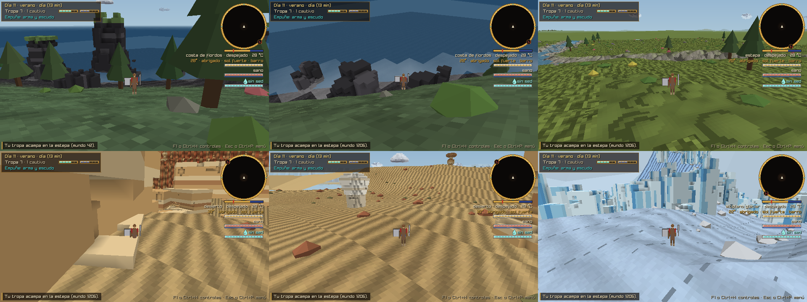

  *Farallones y basalto en los fiordos, roquerío con espuma, arroyo con cantos y rápidos · cañón con farallones en estratos, torre de arenisca y creta, frente de seracs (hasta la v0.14.1).*

  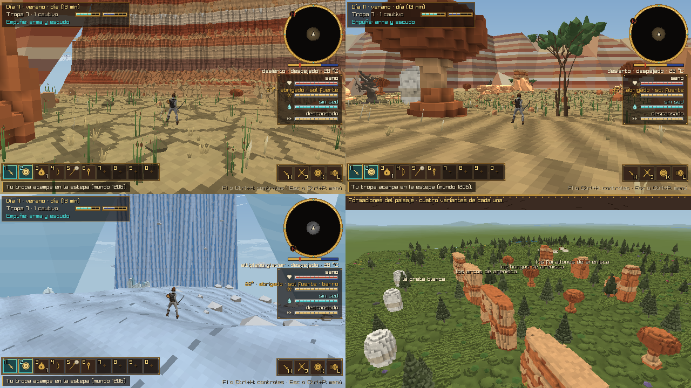

  *v0.14.2: el muro del cañón de cerca (`--ir muro`) y entero (`--ir panorama-muro`), con sus estratos; el frente del glaciar, en columnas, con los bloques caídos al pie (`--ir hielo`); las formaciones de arenisca y la creta (`--formaciones desierto`).*
- **Agua:**
  - es una malla continua sobre la rejilla del suelo (2 m) con el nivel en cada vértice: los ríos bajan en pendiente como un torrente, sin escalones;
  - un vértice seco toma el nivel de sus vecinos con agua, así el borde se mete bajo la orilla y no quedan huecos;
  - lleva una textura de ondas (`assets/terrain/agua.png`) teñida con el color de cada agua;
  - cambia con la estación (v0.11.1, [AGUA.md](AGUA.md)): los cauces secos no tienen agua, y el hielo que aguanta va en su propia malla, con la textura de placas y grietas (`assets/terrain/hielo.png`). Las mallas se rehacen cuando la estación cambia lo suficiente;
  - se mueve con su shader (v0.11.3, [AGUA.md](AGUA.md) fase 4): el vaivén de los lagos, la corriente de los ríos por su cauce, las olas del mar que suben y se retiran en la costa, la espuma de las orillas, las rocas, los rápidos y de quien está en el agua (`assets/terrain/espuma.png`), y la cortina de las cascadas que baja, con su bruma.
- **Vegetación** (`src/world/vegetation.c`, reglas en `src/sim/flora.c`; v0.9.2):
  - pasto, stipa (con sus plumas plateadas en verano), flores de primavera, helechos y juncos alrededor del jugador, por celdas de 2 m como el suelo y sobre su facetado;
  - del color del suelo de su región y su estación; crecen, se secan de pie, el invierno las aplasta y la nieve las tapa donde cubre el suelo (asoman la stipa y los juncos secos);
  - el viento las mece en olas que cruzan el pasto; al pasar se apartan;
  - una ventana de 100 m que sigue al jugador; se dibujan hasta 48 m (24 m en Android), con menos hojas a lo lejos y, desde 24 m (8 m en Android), menos matas pero más anchas (v0.14.7);
  - hasta cuatro matas por m² (v0.14.7; en la v0.14.1, tres): en la estepa, unas 3,4 por m² (el pasto, la stipa, las flores y las hierbas aromáticas; eran 2,5); en el bosque, el pasto entre los helechos, tres veces más tupido que antes;
  - las **hierbas aromáticas** de la estepa (v0.14.1, `FLORA_HERB`): el ajenjo, el tomillo y la salvia, de hojas grises; con las plumas de la stipa echan sus espigas moradas (y algún ajenjo amarillo); se secan, pero el invierno no las tumba del todo;
  - **las matas sueltas del inventario** (v0.14.1, `vegetation_draw_prop`): la hierba alta del escondite (stipa con sus plumas y pasto, de 1 m), las hierbas curativas (salvia, menta y tomillo, en flor mientras están verdes) y el arbusto, con las mismas hojas: se mecen con el viento y toman el color de la estación.
- **Árboles** (v0.10.3, más que antes): densidad 0,85 en el bosque, 0,20 en los fiordos, 0,10 en las faldas del altiplano y hasta 0,36 junto al agua en la estepa; 160 alrededor del campamento inicial (fuera de sus 30 m).
  - **De voxeles** (v0.14.1, `src/world/trees.c`): el pino, el sauce y el arce del inventario (`mapa.vegetacion.*`), del 60 al 100 % de su alto y girados al azar. Junto a los lagos y los ríos (no el mar), sauces: sobre todo en el bosque y la costa, menos en la estepa y el desierto, pocos en el altiplano. En el bosque, uno de cada seis es un arce (de cada diez casillas, tres le tocan al arce y la mitad de esas queda vacía, en damero). Los demás, pinos; los del campamento inicial, también. Los de copa ancha (el sauce y el arce), en una casilla de cada dos (`flora_tree_kind`).
  - **Las estaciones** (`flora_tree_season`): en otoño el arce se pone rojo y naranja; al caer la hoja (y hasta que reverdece) queda pelado, con el tronco y las ramas; con nieve, el pino lleva nieve sobre cada piso de ramas. El sauce es perenne (v0.15.1): como el pino, conserva la hoja todo el año y se nieva. Al pie del glaciar, nevados todo el año.
  - **El detalle:** de cerca (34 m; en Android, 16), el modelo tal cual; a media distancia (72 m; en Android, 40), con celdas del doble; más lejos, del cuádruple (`vox_downsample`). Solo los que caen delante de la cámara; en Android, hasta 85 m. La copa que tapa al personaje, entre él y la cámara lejana, no se dibuja.
  - **Quemados:** los del campamento inicial, en un incendio, se oscurecen; calcinados, queda el tronco negro.

  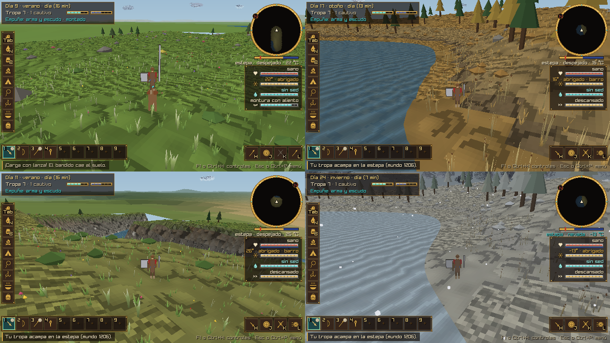

  *Al galope por la estepa en verano · la estepa en otoño · el cañón de un río en verano · tallos secos en la nieve.*
- **Estructuras de voxeles, resolución:** cada modelo se refina al doble (`vox_refine`: cada celda en 2×2×2, esquinas salientes gastadas y rincones rellenos) y lleva tono por celda, piedra a piedra y tabla a tabla. Las murallas de las capitales son tramos de voxeles: piedra con almenas o empalizada.
- **Horizonte lejano:** una malla gruesa, de una celda por chunk, que llega a ~2,4 km bajo los chunks cargados. Deja un hueco donde están los chunks. Así se ven a lo lejos las montañas, los muros, el hielo y el mar. Lo lejano se pierde en una bruma del color del horizonte. Los muros del cañón y del hielo llevan una textura de rampa (v0.14.2, `far_ramp`): cada píxel toma la franja de su altura, así de lejos se ven los mismos estratos que de cerca y no un biombo de triángulos de un color.
- **Cielo** (`src/world/sky.c`):
  - un degradado del cenit al horizonte;
  - el **sol** sale por el este, pasa por el sur a mediodía y se pone por el oeste, con un resplandor cálido cuando está bajo;
  - la **luna** recorre el mismo arco, retrasada según su fase (una luna cada 14 días: nueva junto al sol, llena opuesta);
  - las **estrellas** giran alrededor del polo norte.
- **Nubes de voxeles** (`src/world/clouds.c`, `src/sim/voxel.c`), al modo de Nubis (Guerrilla, *Horizon*):
  - una capa a altura fija, 80 m sobre el llano del campamento; el viento la arrastra y la cobertura sale del clima;
  - cada nube es una rejilla de voxeles de 8 m. La densidad sale de un **perfil dimensional** (gradiente de abajo, de arriba y del borde) erosionado por ruido 3D: `densidad = saturar(ruido − (1 − perfil))`;
  - la luz de cada voxel se hornea en su color:
    - **directa:** transmitancia de Beer-Lambert, marchando por la rejilla hacia el sol, con un toque de polvo en el borde;
    - **ambiente:** entra por arriba y por los bordes;
    - se vuelve a iluminar cuando el sol se mueve unos 8°;
  - tipos: cúmulos, estratos, cielo cubierto y nubarrones de tormenta (3 plantillas de cada uno); las cumbres altas llevan un **gorro** en anillo;
  - lejos (más de 950 m), cada nube pasa a carteles pixelados del atlas `assets/sky/nubes.png`, sacado de fotos con `tools/assets/nubes.py`;
  - con la cámara dentro de una nube (según la densidad de sus voxeles), la vista se cubre de niebla.
- **Estructuras de voxeles** (`src/world/voxstruct.c`): cada estructura del mundo y cada casa son un modelo de voxeles de 0,25 a 0,5 m.
  - **Malla:** solo las caras expuestas, como en la representación por voxeles de nubes de puntos, con oclusión ambiental por vértice y sombreado por cara.
  - **Ruinas** (v0.10.2): la fortaleza derruida y la ciudad enterrada salen del kit de edificios, con la muralla de su región o las casas de ladrillo de adobe del desierto. Las fortalezas (v0.14.2): las grandes, con el torreón del homenaje de tres pisos y torres en ruinas de uno a tres pisos en las esquinas; las chicas, una torre sola con un pedazo de muralla (ver [ARQUITECTURA_EDAD_DEL_HIERRO.md](ARQUITECTURA_EDAD_DEL_HIERRO.md)). Las nueve de más se agregan al final de los sitios, con su propio azar, y después otras doce fortalezas y cuatro ciudades enterradas (v0.14.7, `place_more_ruins`): las partidas viejas valen (los sitios vistos pasan de 64: los de después, en `seen_sites_hi`). Después pasa el tiempo: cada columna pierde lo de arriba hasta una altura que da el ruido (lo alto cae primero y nada queda en el aire), lo caído se amontona al pie y crece el pasto, el musgo o la arena. Cada ruina es una de cuatro variantes, según donde esté.
  - **Asentamientos antiguos** (v0.14.0): los vestigios de un pueblo de otros tiempos, como en las excavaciones (Ras Ibn Hani, Elefantina). La planta (`src/sim/ancient.c`, de una semilla) es un palacio de cuartos alrededor de su patio y de tres a seis casas de dos a cinco cuartos, separadas por calles, en un cuadrado de 44 m. Los muros son de ladrillo sobre zócalo de piedra, y el tiempo dejó poco: casi todos a ras del suelo, con brechas y puertas, y de dos a cuatro tramos de pie (el muro en ruinas del inventario). De uno a tres por región (tres en la estepa, dos en el desierto y el altiplano, uno en el bosque y los fiordos), en un llano; se agregan después de los demás sitios, así que las partidas viejas valen. `--ir asentamiento`.
  - **Color por región:** arenisca en el desierto, liquen en el bosque y la costa.
  - **El ladrillo** (v0.14.2, `M_BRICK`): el mallador lo traba (`VoxGrid.brick`): cada ladrillo, dos celdas de un tono; cada hilada, corrida media pieza; la junta, más oscura abajo y al principio de cada ladrillo. De adobe en el desierto, cocido en lo demás. Lo llevan la ciudad enterrada, las fortalezas del desierto y los asentamientos antiguos.
  - **Los edificios de las ciudades, las aldeas y las tribus** salen del kit de la edad del hierro (`src/sim/buildkit.c`, v0.10.0): la yurta y la carreta-casa en la estepa (rehecha en la v0.14.1: la casilla de fieltro sobre la plataforma, la plataforma sobre los ejes y cuatro o seis ruedas de rayos de 1,25 m por fuera, sin tocarse), la casa de postes y paja en el bosque, la de piedra y adobe en el altiplano, la casa larga de turba en los fiordos y la de adobe con patio en el desierto; cada tipo y región con cuatro variantes (dos chicas, dos grandes), el palacio, los talleres, los graneros y el templo del fuego. De cerca (menos de 32 m), refinados; de lejos, simples. Ver [ARQUITECTURA_EDAD_DEL_HIERRO.md](ARQUITECTURA_EDAD_DEL_HIERRO.md). La muralla de las capitales (v0.10.2), también del kit: el muro y las torres de su región, y la puerta acodada con su antemuro.
  - **Claro:** alrededor de las estructuras y los campamentos no crecen árboles ni rocas.
- **Barrancos del altiplano:** son permafrost; sus paredes son hielo (seracs) todo el año. Un lago o un río no flota sobre un cañón: donde el suelo cae muy por debajo de su nivel, manda el agua de abajo.
- **Fogatas y hogueras** (`src/world/hearth.c`), a partir de fotos de fogatas reales:
  - corro de cantos grises de tamaños distintos, algunos tiznados, sobre ceniza y tierra quemada;
  - leños en tipi con la corteza abajo y la punta carbonizada, y dos troncos cruzados en el lecho;
  - brasas que laten y lenguas de llama en capas: roja por fuera, naranja, amarilla y un corazón casi blanco; tiemblan, se mecen y el viento las inclina;
  - chispas que suben girando, se enfrían (amarillo, naranja, rojo) y se apagan;
  - **humo:** pequeñas bocanadas oscuras que salen sobre las llamas y suben en hilera; el viento las inclina y, al subir, crecen, se aclaran y se desvanecen. De noche se oscurecen con el cielo;
  - la **hoguera** es la misma fogata al doble de tamaño: más piedras, más leños, llamas más altas y una columna de humo más larga. La capital también tiene una;
  - las tribus y las aldeas tienen la suya. Con la lluvia, todas quedan apagadas: sin llamas ni humo.

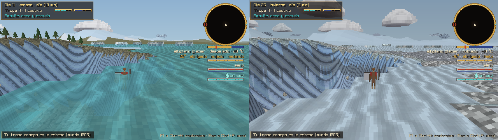

*Un cañón del altiplano en verano y en invierno: sus paredes son hielo todo el año, y el río corre en el fondo (antes un lago de arriba quedaba flotando sobre el barranco).*

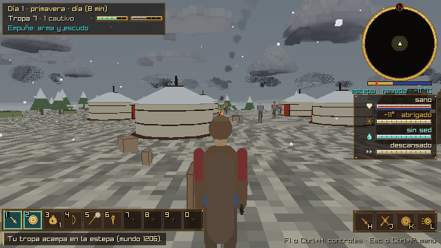

*El HUD: el minimapa (lo explorado muestra su geografía; lo demás, a oscuras), la placa de las constantes, la barra rápida 1-9 y 0 y los cuatro botones de combate (las acciones, en `Tab`). La cámara, cerca: `N` cambia de vista.*

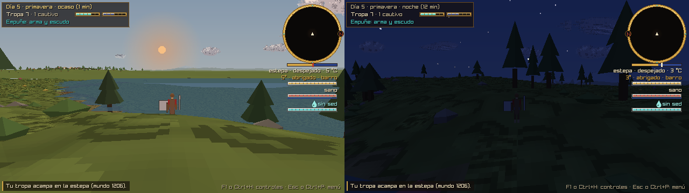

*El ocaso al oeste y la luna creciente al este, de noche.*

## El decorado de OpenGameArt

Los 41 modelos del paquete *FREE Remastered Meadows* (EmacEArt, CC0), adaptados a la estética del juego con
`tools/modelos/adaptar_oga.py`, se siembran en la capa 4, la dispersión. Las normas están en `src/sim/decor.c`:
región, agua, pendiente, nieve, tamaño y cuánto se entierra cada uno. La siembra está en `src/world/terrain.c`:
`seed_decor`, al armar cada trozo. Todo sale de la semilla y de la casilla, y cada trozo siembra lo suyo sin
mirar si los vecinos están cargados.

- **Lo natural, por casillas:**
  - crestas de roca de 77 y 112 m, en casillas de 96 m: altiplano y fiordos;
  - rocas, colinas y acantilados, en casillas de 24 m;
  - rocas bajas, árboles y arbustos, en casillas de 12 m.

  Cada casilla da una cosa o nada, con la chance de su modelo por región. Una casilla cede su lugar ante otra de
  una clase mayor que la pisaría y que también puede ir ahí.
- **El suelo bajo toda la huella:**
  - nada en el agua; lo seco, a más de 2 m sobre el agua;
  - los peñascos del pantano y el sauce muerto, solo junto al agua dulce, con un borde en el agua baja;
  - ni en el lecho de un río ni donde llega el glaciar;
  - la pendiente de su norma, y que no flote de un lado. Se entierra un poco.
- **Lo que siempre respeta:**
  - el campamento inicial (150 m) y el borde del mundo;
  - el cañón del desierto y el frente del glaciar (sus formaciones de voxeles);
  - el muro tras el canal;
  - los pueblos con sus campos y sus afueras, las estructuras, los campamentos y las cuevas;
  - los árboles: no pisa ninguno en el núcleo de su huella.
- **Al pie de los árboles del bosque:** hongos, ramas caídas y raíces, cinco por trozo como mucho.
- **Lo hecho por el hombre, solo donde tiene sentido (`decor_layout`):**
  - en las afueras de los pueblos: tramos de cerca a lo largo del borde de los campos, un carro, un banco,
    barriles y tablas;
  - junto a los campamentos de las tribus: un corral, un carro y barriles;
  - alrededor de las ruinas: restos (tablas, una cerca caída, barriles, a veces un carro o un cofre);
  - un puente sobre un arroyo (`decor_bridge`, v0.15.0):
    - el cruce más corto a menos de 220 m de cada pueblo, fuera de sus campos y de los demás lugares;
    - de orilla alta a orilla alta: las dos orillas suben a 1,2 m o más sobre el agua, y el puente se apoya en el
      hombro de cada una, donde el suelo deja de subir;
    - las dos puntas, en tierra, y de cada una se sale a una orilla pareja;
    - el tablero, en arco, de 1,8 a 8 m sobre el agua en el medio;
    - el modelo se escala hasta 1,2 y se estira a lo largo hasta 2,2 para cubrir la luz;
    - árboles, rocas, formaciones y el resto del decorado lo esquivan (`near_bridge`);
  - un muelle en la orilla baja de un lago o del mar a menos de 400 m de un pueblo o campamento: la tarima en tierra
    y dos tramos sobre el agua.

El censo del mundo entero (`--censo-decorado`) dice cuántos hay de cada modelo y por qué se descarta cada candidato.
Para mirarlo: `--ir puente`, `--ir muelle` y `--sin-decorado`, para comparar antes y después.

## Las colisiones

Lo más sencillo posible (v0.15.0): sin física, círculos y cápsulas en el suelo, y solo para el jugador (y su
montura). Cada cuadro mira los nueve trozos de alrededor.

- **Lo que está en el suelo lo empuja afuera** (`terrain_collide`, `src/world/terrain.c`):
  - el tronco de los árboles;
  - las rocas de 60 cm o más (cada trozo anota las suyas al armarse);
  - el decorado que choca (`decor_collider`, `src/sim/decor.h`): un círculo para el tronco de los árboles, dos postes
    para el portal y el marco, y una cápsula a lo largo para lo demás (rocas, colinas, cercas, carros, bancos,
    barriles, cofres).

  Lo que no pasa de las rodillas (45 cm) se pisa: los hongos, las ramas, las raíces, las tablas y la cerca caída.
- **Las obras lo frenan** (`collide_player`, `src/main.c`): los edificios, las ruinas y las formaciones de vóxeles
  dibujados cerca (su ocupación, `voxs_solid_at`) y las estructuras del campamento.
  - Se miran a la altura de las rodillas y del pecho, un radio por delante.
  - Si el paso choca, prueba girado a uno y otro lado (y más corto), así se desliza a lo largo de la pared o rodea
    lo redondo; si nada pasa, se queda.
- **Lo que se camina** (`terrain_ground`): el puente, los muelles y la tarima son suelo para quien viene a su altura
  (hasta 60 cm por debajo). Sobre ellos no se nada, y por debajo se puede pasar a nado.
- **Las rocas se trepan** (v0.15.1): cada roca (las del trozo y el decorado de `decor_climbable`, de la cresta a la
  roca baja) es una cúpula sobre su huella, un círculo o una cápsula a lo largo del modelo. Empuja afuera solo si su
  superficie, junto al jugador, pasa de su alcance: 50 cm en el suelo (un paso) y 1,9 m en el aire (toma el borde al
  saltar). Si no, es suelo (`terrain_ground`).
- **Los árboles chocan:** el tronco de los pinos y los demás árboles del trozo empuja afuera con un radio de
  0,3 m + 0,15 m por su escala.
- **El campamento inicial choca** (v0.15.2, `collide_player`): el tronco de sus pinos, sus yurtas (a una yurta no se
  entra desde afuera), el fogón y sus cosas de 50 cm o más (la caja de sus medidas, con su giro) lo empujan afuera.
- **Las rocas de cada región** (v0.15.2, `props_draw_item_biome`): cada roca del decorado se dibuja con la variante de
  la región de más peso donde está. La variante es la misma roca con la piedra de esa región y, en lo que mira arriba,
  lo que la cubre: liquen seco en la estepa, musgo en el bosque, nieve en el altiplano, liquen mojado en los fiordos y
  polvo de arena en el desierto (con vetas). Se arma al cargar la roca la primera vez, sin archivos nuevos.

En las capturas, la línea `Jugador: (x, y, z)` dice dónde terminó. Con `--caminar adelante` sirve para probar un
choque.

## Parámetros para afinar

Están todos en `src/sim/world.c`, salvo donde se indica otro archivo.

| Parámetro | Dónde | Efecto |
|---|---|---|
| `WORLD_RADIUS` | `world.h` | Radio medio de la tierra. |
| `world_edge_radius()` | borde | Lo fractal del borde: amplitud y octavas del ruido. |
| `STEPPE_R` y su ruido | arriba | Radio de la estepa central. |
| `SECTOR_ANGLE[]`, `SECTOR_HALF`, `SECTOR_BLEND` | arriba | El cuadrante de cada región y la transición entre ellas. |
| `ALTITUDE[]` | arriba | Altitud media de cada región. |
| `region_detail()` | relieve | Relieve propio de cada región. |
| `PEAK_RULES[]` | `world_generate` | Montañas por región: cuántas, alturas y radios. |
| `CANAL_E`, `CANAL_SWING`, `CANAL_HALF`, `CANAL_DEPTH` | arriba | El canal sigmoideo del bosque. |
| `SHORE_E`, `fjord_inlet()` | arriba | La costa y lo que entran los fiordos. |
| `WALL_E`, `GORGE_E` | arriba | El cañón y el muro de estratos del desierto; en `world_height`, sus promontorios, cárcavas, contrafuertes, macizos y agujas. |
| `ICE_E` | arriba | El muro de hielo del altiplano; en `world_height`, sus columnas, macizos, cumbres y agujas. |
| Las cordilleras de frontera | `world_generate` | Los cerros entre el altiplano y el desierto, y entre el altiplano y la costa. |
| `REGION_RAIN[]`, `GLACIER_MELT` | `make_water()` | Cuánto llueve en cada región y cuánto da el deshielo. |
| `FLOW_CREEK`, `FLOW_RIVER`, `FLOW_BRAID` | `make_water()` | Desde cuánta agua nace un arroyo, un río y un río trenzado. |
| `LAKE_MIN_DEPTH`, `LAKE_MIN_CELLS` | `make_water()` | Qué depresión es un lago. |
| `stream_meanders()`, `FALL_DROP`, `FALL_SLOPE` | `make_water()` | Los meandros y las cascadas. |
| `HYDRO_EPS`, `HYDRO_SIDE` | `src/sim/hydro.h` | La hidrología: cuánto sube el agua en lo llano y el tamaño de la grilla. |
| Oasis 3–4 | `world_generate` | Los oasis del desierto. |
| `tree_density()` | `src/world/terrain.c` | Árboles por región (bosque tupido: 0,62). |
| `ground_color()`, `ground_tex()` | `src/world/terrain.c` | Color y textura del suelo. |
| `FAR_CELLS`, `FAR_HAZE_NEAR` | `src/world/terrain.c` | Alcance del horizonte lejano y su bruma. |
| `STRATA[]`, `STRATA_ORDER[]`, `ICE_LAYERS[]`, `BAND_ROWS` | `src/world/terrain.c` | Los colores de los estratos y de las capas del hielo, por altura (de cerca y de lejos). |
| `place_more_forts()` | `world_generate` | Las fortalezas derruidas de más, por región. |
| `place_more_ruins()` | `world_generate` | Más fortalezas, en todas las regiones, y más ciudades enterradas, en el desierto (al final de todo). |
| `SKY_LUNAR_DAYS`, `arc_dir()` | `src/world/sky.*` | Fases de la luna y arco del sol. |
| `CLOUD_ABOVE_PLAIN`, `CLOUD_VIEW`, `CELL`, `VT_DIM`, `VOX_NEAR` | `src/world/clouds.*` | Altura de las nubes, alcance, celda de cada nube, tamaño de las rejillas y distancia de los voxeles. |
| `vox_cloud_shape()`, `vox_cloud_light()` | `src/sim/voxel.c` | Perfil y erosión de las nubes; extinción y ambiente de la luz. |
| `build_site()`, `build_building()` | `src/world/voxstruct.c` | Las estructuras, las torres y las murallas de voxeles. |
| `bk_build()`, `house()`, `palace()`, `seal()` | `src/sim/buildkit.c` | El kit de edificios: plantas, medidas, materiales y detalles de cada región; el relleno de lo de adentro. |
| `house_lot()`, `VOXS_KIT_NEAR` | `src/game/city_game.c`, `src/world/voxstruct.h` | Qué edificio y qué variante va en cada lote de casa; hasta dónde van refinados. |

## Cómo verlo

```bash
./build/estepa --semilla 42 --mapa-mundo mapa.png         # mapa general (1024 px; --mapa-tam N cambia el tamaño)
./build/estepa --semilla 42 --orbital 30 0.5              # vista orbital: grados alrededor e inclinación (0 de canto, 1 desde arriba)
./build/estepa --semilla 42 --ir muro --dia 11 --minuto 7 # a pie de un sitio (ver la lista abajo)
./build/estepa --ir estepa --dia 5 --minuto 18 --camara 0.06 --rumbo 90   # la luna al este, de noche
```

Sitios de `--ir`:
- **Regiones y paisaje:** estepa, meandro, arroyo, rapidos, bosque, canal, altiplano, trenzado, hielo, cumbre, fiordos, mar, desierto y muro; panorama-hielo y panorama-muro (los muros enteros, a 520 m del borde).
- **El agua:** lago (el más grande fuera del bosque), desborde (por donde sale su río) y cascada (la más grande tierra adentro).
- **Pueblos y fieras:** capital, aldea y guarida; `capital-<región>`, `aldea-<región>` y `plaza-<región>` (en la plaza, frente al palacio) para las de cada región (estepa, bosque, altiplano, fiordos o desierto); kanato (la plaza de la capital de la estepa) y campos.
- **Tribus:** tribu (amiga), rival y neutral.
- **Estructuras:** kurgan, balbales, piedra, fortaleza, ciudad, petroglifos, caravasar, torre, ovoo, pozo y embarcadero.
- **Fuegos:** fogata (la del campamento, de cerca) y hoguera (pone una junto a ella).

`--camara` fija la inclinación: 0,05 es casi de canto, con el cielo a la vista; 1,25 es desde arriba. `--rumbo` fija los grados: 0 sur, 90 este, 180 norte, 270 oeste. `--dron <m>` aleja la cámara (para ver una ciudad entera; con `--edificios`, la acerca o la aleja de las variantes), `--edificios tipo[:región]` muestra las variantes del kit de edificios y `--formaciones desierto|hielo|costa`, las de las formaciones del paisaje.

En el juego, **F5** abre la vista orbital (flechas: girar e inclinar).

### Mapas generales

| | |
|---|---|
| 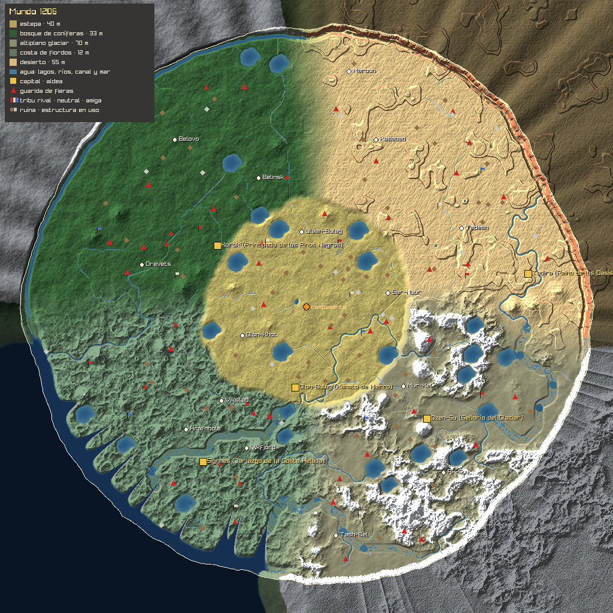 | 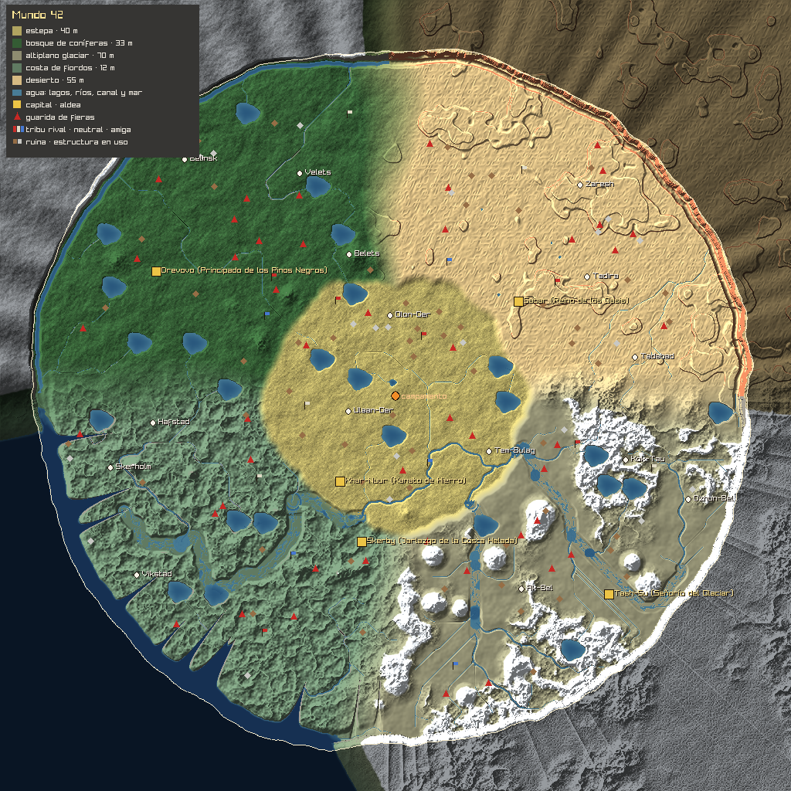 |
| 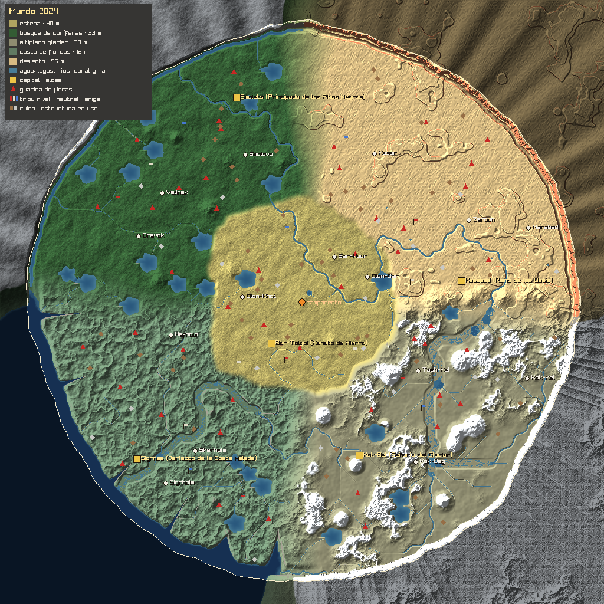 | 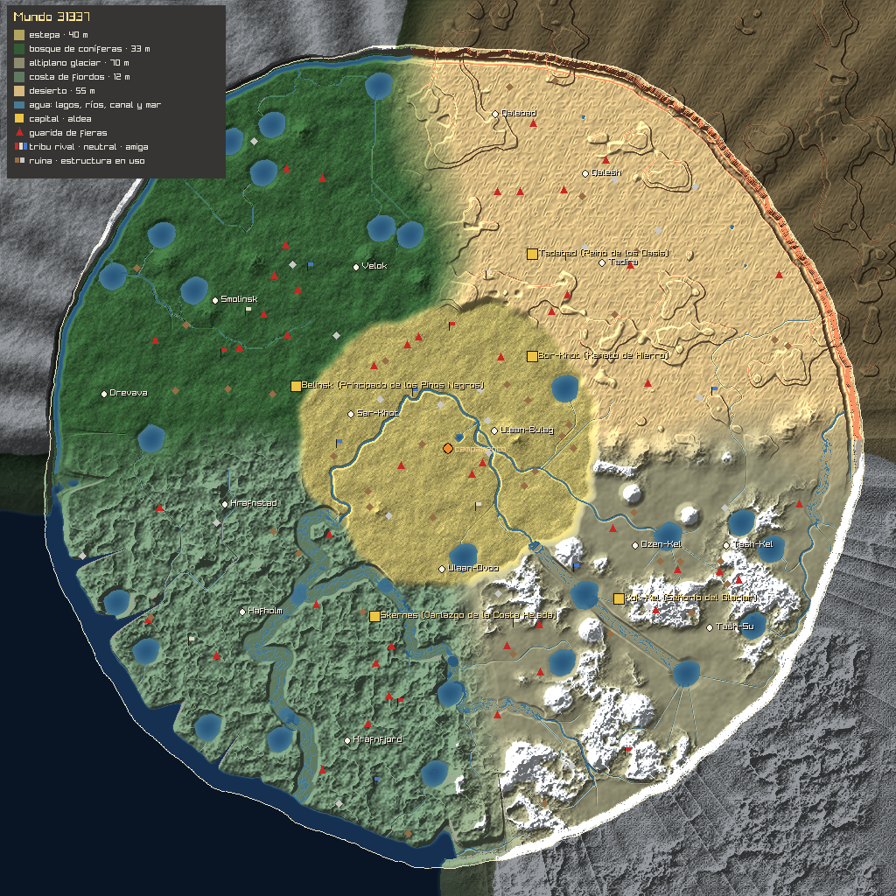 |

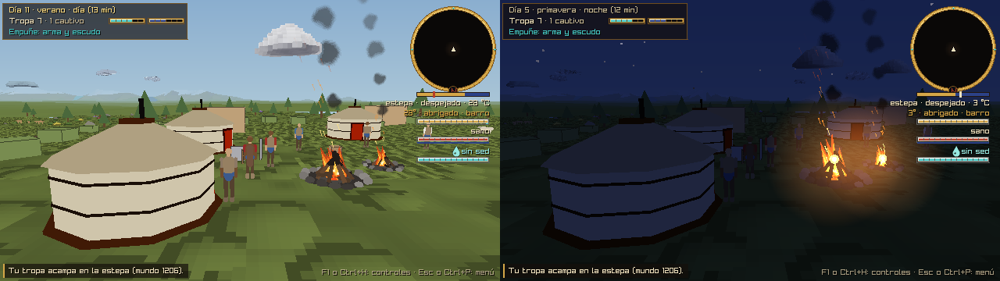

*Una hoguera junto a la fogata del campamento, de día y de noche (`--ir hoguera`).*

### Vista orbital

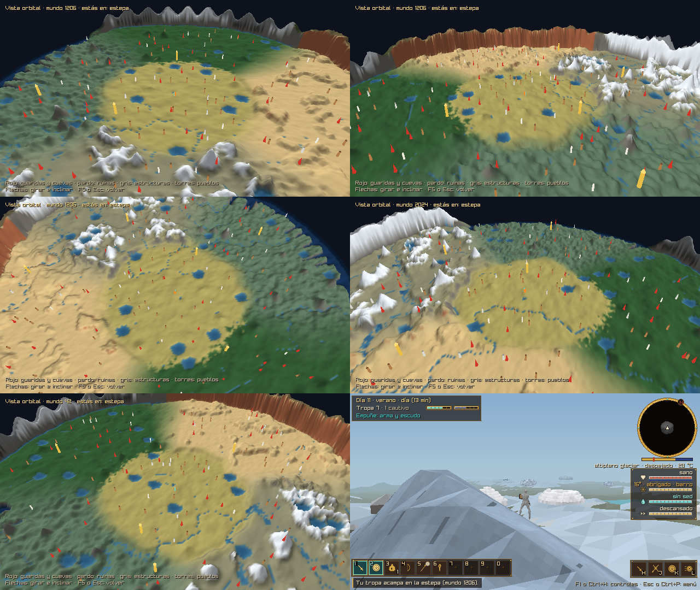

### A pie

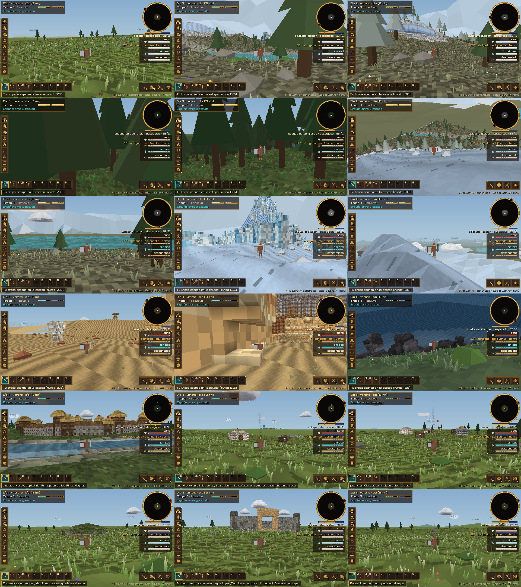

*Estepa, meandro, arroyo · bosque, canal, altiplano · río trenzado, muro de hielo, cumbre entre las nubes · desierto, muro de estratos, mar · capital del bosque, tribu amiga, tribu rival · kurgán, caravasar, ovoo.*
